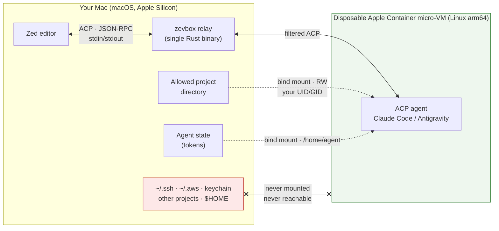
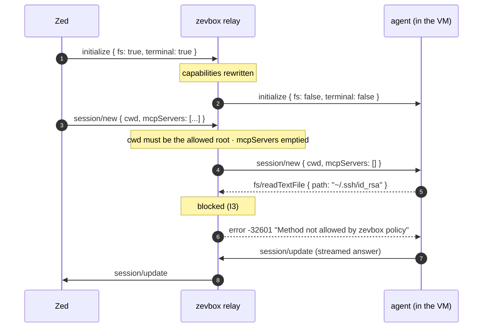
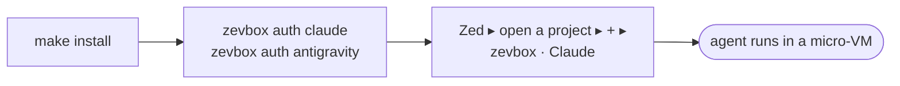
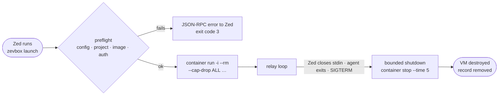

# zevbox — run AI coding agents for Zed inside Apple Container micro-VMs

**English** · [Français](docs/fr/README.md)

**zevbox** lets you use ACP agents (**Claude Code**, **Google Antigravity**) from the
[Zed](https://zed.dev) editor while keeping them off your Mac. Each agent runs inside a
disposable **Apple Container** Linux micro-VM — a real hardware-isolated virtual machine, not a
shared-kernel container — and talks to Zed through a **filtering ACP relay** that strips every
request which would let the agent read, write or execute anything on the host through the
editor.

Single Rust binary · macOS on Apple Silicon (arm64) · no daemon · no Docker.

---

## Why

When Zed starts an ACP agent the normal way, the agent runs **as you, on your Mac**. It can read
`~/.ssh`, `~/.aws`, your keychain-backed CLIs and environment variables; it can run any command;
and the ACP protocol itself lets it ask the editor to read, write and execute on its behalf
(`fs/*`, `terminal/*`). One prompt injection in a README you asked it to summarise is enough.

zevbox gives the agent exactly two things — **your project directory** and **its own state
directory** — and nothing else:

| | Agent run by Zed directly | Agent inside zevbox |
|---|---|---|
| Your `~/.ssh`, `~/.aws`, keychain, other projects | readable | **not mounted, not visible** |
| Shell on the Mac | yes | **no** — commands run inside a throwaway Linux VM |
| `fs/*`, `terminal/*` ACP requests to Zed | honoured | **blocked by the relay** (I3) |
| Files created outside the project | land on your Mac | **gone when the VM exits** |
| File ownership of project edits | your user | **your user** (same UID/GID, no root-squash) |
| Agent start-up | instant | **< 1 s** (micro-VM boot) |

### What it looks like



The relay is the second half of the story. ACP lets an agent ask the *editor* to read files,
write files or open a terminal **on the host**. zevbox answers those requests itself and Zed
never sees them:



### Why Apple Container rather than Docker

- **Hardware boundary.** Every container is its own micro-VM on `Virtualization.framework`
  (ARM EL2). A kernel exploit inside the VM still has to cross the hypervisor.
- **Fast.** Micro-VMs boot a minimal Linux kernel in well under a second.
- **Native file sharing.** `virtiofs` gives near-native I/O on the mounted project.
- **Correct permissions.** zevbox maps your macOS UID/GID into the VM; edits are owned by you.
- **Disposable.** `--rm` + `--cap-drop ALL`: nothing persists outside the two mounts, and root
  inside the VM has no Linux capabilities.

---

## Quick start

Requirements: Apple Silicon Mac, [Apple Container](https://github.com/apple/container) ≥ 1.5.0
(`container system status` → `running`), Zed, Rust toolchain.

```bash
# 1. Build and install the release binary into ~/.local/bin/zevbox
make install

# 2. Sign in to each agent once (any order). On first use `auth` also initialises zevbox
#    and builds the agent image (network, 1–3 min); afterwards it rebuilds nothing.
zevbox auth claude        # Claude account (Pro/Max) — runs in an interactive container
zevbox auth antigravity   # Google account (AI Pro / One AI Premium) — OAuth PKCE on the Mac
```



Zed now shows two agent servers, **`zevbox · Claude`** and **`zevbox · Antigravity`**. Open a
project in Zed and pick one with **+**: choosing it is your consent, there is no list of projects
to maintain. The project must be a folder inside your home folder (not `~/Library` nor a hidden
`~/.…` folder) or on an external disk; anywhere else the agent answers `… is not an allowed
project` (invariant I2 — folders whose files the Mac runs by itself are never mounted in a VM).
`zevbox setup` does all of the above in one go; `init`, `update` and `auth` stay available
separately (see the command reference).

> Both `auth` commands print the sign-in URL: if your browser does not open by itself, paste it.

Full walkthrough with checks: **[docs/USER_GUIDE.md](docs/USER_GUIDE.md)**.
How it works and why: **[docs/ARCHITECTURE.md](docs/ARCHITECTURE.md)**.
Documentation en français : **[docs/fr/](docs/fr/README.md)**.

---

## Everyday use

- **In Zed**: open a project, open the agent panel, pick **zevbox · Claude** or
  **zevbox · Antigravity** with **+**. The project is the one open in Zed (its first root folder).
  The agent runs in a dedicated, temporary Linux VM with your source mounted under your own
  UID/GID. Its file changes appear in your folder immediately.
- **Commit the agent's work yourself** (or with any tool outside zevbox): inside the VM the
  project's `.git` is read-only, so the agent can read the history but cannot commit (I13).
- **Interactive shell in the agent's VM**: `zevbox shell claude`
- **Extra Linux tools (apt packages) in the VMs**: `zevbox tools add ripgrep clang`
- **Check and diagnose**: `zevbox status` · `zevbox doctor`
- **Stop every running instance**: `zevbox stop`

---

## Command reference

| Command | What it does |
|---|---|
| `zevbox setup` | Guided, idempotent set-up: writes the configuration, builds missing releases (`update`), offers `auth` for each unauthenticated agent (terminal only), configures Zed, runs `doctor` and prints a per-agent summary. One agent failing to build does not block the other; the exit code is 1 if an agent still has no release at the end. |
| `zevbox init` | Creates the state directories (`~/.local/share/zevbox` or Application Support) with mode `0700`, plus `config.json` and `tools.json`. |
| `zevbox doctor [--json]` | Full health check: `container` ≥ 1.5.0, runtime running, arm64, releases present, disk used by zevbox images (WARN when old ones can be reclaimed), `0700` permissions. |
| `zevbox zed install [--dry-run]` | Non-destructively inserts the managed `zevbox · …` entries into `~/.config/zed/settings.json`, preserving comments and formatting (CST edit). Automatic backup in `backups/`. |
| `zevbox zed uninstall` | Removes all managed entries from Zed and restores the settings byte for byte. |
| `zevbox auth <agent> [--status]` | Claude: runs the interactive login in a `-it` container. Antigravity: runs the Google OAuth 2.0 PKCE flow **on the Mac** (ephemeral HTTP server on `127.0.0.1:<random port>`, no port published on the VM, no keychain access) and writes `state/antigravity/.gemini/antigravity-acp/{settings.json,acp_token.json}` with mode `0600`. `--status` prints `authenticated`, `not authenticated` or `unknown`. |
| `zevbox launch <agent> [--project <path>]` | Called by Zed: checks the project against the allowed zones (I2), starts the micro-VM and relays ACP over stdin/stdout with strict filtering, and watches the project (I13). Without `--project`, the project is the current directory (Zed starts the agent in the first root folder). |
| `zevbox status [--json]` | Shows active, orphaned and unregistered instances. |
| `zevbox stop [ID \| --project <path>]` | Cleanly stops the given instances, or every active zevbox instance (never with the global `--all`), and prints one line per instance stopped. A recorded process is signalled only if it is still the same relay (never a process that merely reuses its number after a reboot); a relay that does not answer within 10 s has its container stopped directly. |
| `zevbox clean [--images]` | Removes verified orphan containers and stale records, prunes old logs (>30) and backups (>20). With `--images`, deletes the zevbox images of releases that are neither current nor previous (never another tool's images) and removes the image builder VM, whose disk never shrinks. |
| `zevbox shell <agent> [--project <path>]` | Interactive Bash in a disposable VM identical to the agent's. Without `--project`, the current directory must be in an allowed zone (exit code 3 otherwise). |
| `zevbox logs [ID] [--path]` | Shows the last 200 lines of the most recent session log, or of the given ID. `--path` prints the log file path. |
| `zevbox update [--check] [--agent <agent>]` | Checks for or builds a new agent release from the official ACP registry, runs the smoke test and promotes it. Exits with code 1 if any agent's update failed (it then changes nothing for that agent). After a build, the same image cleanup as `clean --images` runs. |
| `zevbox rollback [--agent <agent>]` | Swaps the active release (`current`) with the previous one; refuses, with the fix to run, if the previous release's image no longer exists. |
| `zevbox tools list` / `add <pkgs…>` / `remove <pkgs…>` | Manages extra Debian packages (`tools.json`) and rebuilds the active agent images. |

---

## Session lifecycle



## What persists, what does not

| Data | At the end of an instance |
|---|---|
| **Project code** | Stays on the Mac (edits visible immediately, same UID/GID). |
| **Agent credentials** | Persist in `state/<agent>` (mounted at `/home/agent` in the VM). |
| **Temporary files outside the project** | Deleted with the container (`--rm`, disposable VM). |
| **Session logs** | Persist in `logs/<instance_id>.log` (rotation at 30 files). |
| **Instance record** | Removed from `instances/<instance_id>.json` on clean shutdown. |

---

## Security invariants

These are enforced by tests and by `scripts/check-invariants.sh` on every `make check`, and are
never weakened to make a test pass:

- **I1 — Two mounts only**: the project directory and the agent's state sub-directory. Never `$HOME`, `~/.ssh`, `~/.claude`, …
- **I2 — Projects in allowed zones**: a project is a canonical folder strictly inside your home folder (not `~/Library`, not a hidden `~/.…` folder) or on an external disk under `/Volumes`; `/`, system folders, `/Applications`, `/opt/homebrew` and zevbox's own folders are refused. Writing in those folders would let the Mac run the agent's code.
- **I3 — No host access through Zed**: every ACP request asking the editor for filesystem (`fs/*`), terminal (`terminal/*`) or terminal-based authentication is intercepted and rejected.
- **I4 — Allow-list both ways**: only known, safe ACP methods pass between Zed and the agent; responses are routed by pending request id.
- **I5 — Confined `cwd`**: the working directory is always exactly the project root; `mcpServers` is emptied.
- **I6 — Pure JSON-RPC on stdout**: in `launch` mode stdout carries nothing but JSON-RPC, so Zed never sees garbage.
- **I7 — No host shell**: zevbox never spawns `sh`, `bash` or `zsh` on the Mac.
- **I8 — Surgical container targeting**: `container stop`/`delete` never use `--all` and only touch containers with the `zevbox-` prefix **and** the zevbox label.
- **I9 — Private logs**: no token, credential or message content is ever logged or printed on error.
- **I10 — No network or build in `launch`**: launching uses the active release only.
- **I11 — No panics in production**: zero `unwrap()`, `expect()`, `panic!()` in `src/` (Clippy `deny`).
- **I12 — zevbox is out of reach**: its binary, configuration and releases are never mounted into a container.
- **I13 — Project files the Mac would run**: in the VM, the project's `.zed` folder is masked (the agent's edits stay in VM memory) and an existing `.git` is read-only. During the session zevbox watches the project and stops the agent if a `.git` appears or changes anywhere else. Reason: Zed runs programs named in `.zed/settings.json` and in git settings by itself ([EXP-01](docs/experiments/EXP-01-resultats.md)).

### Threat model and known limits

zevbox protects **your Mac** from the agent. It does **not** protect the project you hand to it:

- the agent can modify or delete anything in the mounted project;
- the agent has network access, so it can exfiltrate the project's contents;
- the agent has access to its own credentials (that is what the state mount is for);
- anything you deliberately send from Zed (attached files, pasted text) reaches the agent;
- there is no defence against a vulnerability in the Apple Container runtime or in the relay itself.

---

## Troubleshooting by error message

- **`zevbox is not set up. Fix: run 'zevbox setup' or 'zevbox init'`** — run `zevbox setup` in a terminal.
- **`<path> is not an allowed project: <reason>. Fix: open a folder inside your home folder …`** — the folder open in Zed is outside the allowed zones (I2), for example a hidden `~/.…` folder or a system folder. Move the project or open another folder.
- **`zevbox: stopped the agent: it created or changed git metadata at <path>`** — the agent created a git repository (or changed one) inside the project (I13). Review that path and delete it before using git or reopening the project in Zed.
- **`no active Claude release. Fix: run 'zevbox update --agent claude'`** — the agent image has not been built yet.
- **`Claude is not authenticated. Fix: run 'zevbox auth claude'`** — sign in from a terminal.
- **`Antigravity is not authenticated. Fix: run 'zevbox auth antigravity'`** — sign in with your Google account in the browser.
- **`zevbox: this agent is bound to <A>; this session asked for <B>. Open <A> in Zed, or open <B> in its own Zed window …`** — the Zed session asks for a different folder than the one the agent was launched in, typically a multi-root workspace. Open one root folder per Zed window.
- **`Auto mode unavailable: the selected model does not support Auto mode`** — Claude's default model in the VM is Haiku 4.5. `zevbox doctor` reports `no default model`; run `zevbox auth claude` (writes `state/claude/.claude/settings.json`) or write `{"model": "fable"}` there, then open a new Zed thread.
- **`Apple Container system is not running, and zevbox could not start it. Fix: … run 'container system start' …`** — zevbox normally starts the runtime itself (e.g. after a reboot); when it cannot, run that command in a terminal and start a new thread in Zed.

---

## Contributing

Issues and pull requests are welcome. `make check` (fmt, clippy with `-D warnings`, tests,
invariants) must pass; `tests/**` and `scripts/**` are protected by a SHA-256 manifest and are
not meant to be edited to make a change pass. [AGENTS.md](AGENTS.md) describes the module map,
invariants and workflow — it is written for AI coding agents but is the best short orientation
for humans too. Design history lives in `docs/DECISIONS.md`, `docs/PROGRESS.md` and the plans
`zevbox_plan_V2.md` (current contract) / `zevbox_plan_V1.md` (superseded); these working
documents are in French. User documentation is bilingual: English here and in `docs/`, French under `docs/fr/`.

## License

Dual-licensed under either of

- [MIT License](LICENSE-MIT)
- [Apache License, Version 2.0](LICENSE-APACHE)

at your option. Unless you explicitly state otherwise, any contribution intentionally submitted
for inclusion in this repository shall be dual-licensed as above, without any additional terms or
conditions.
