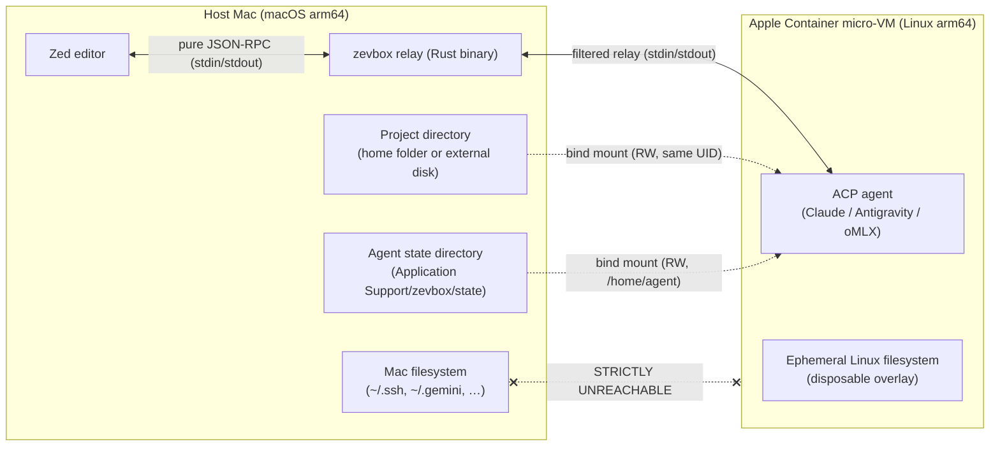
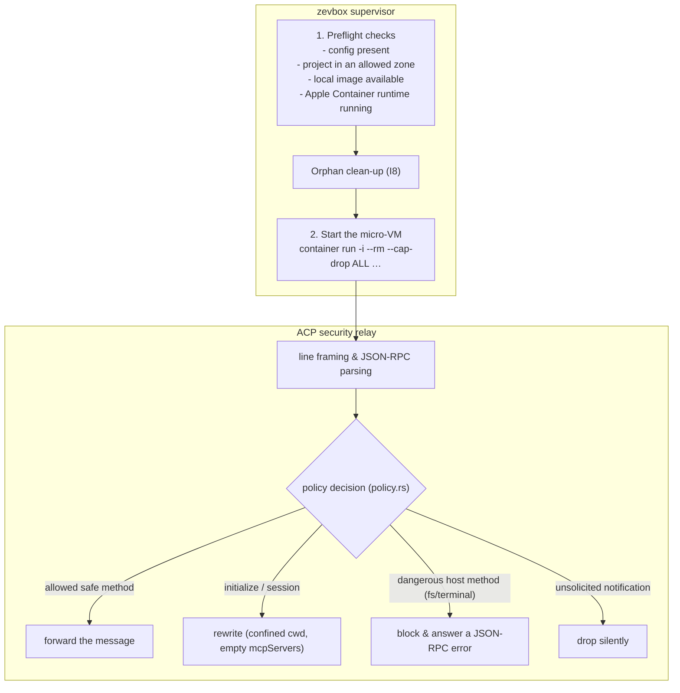
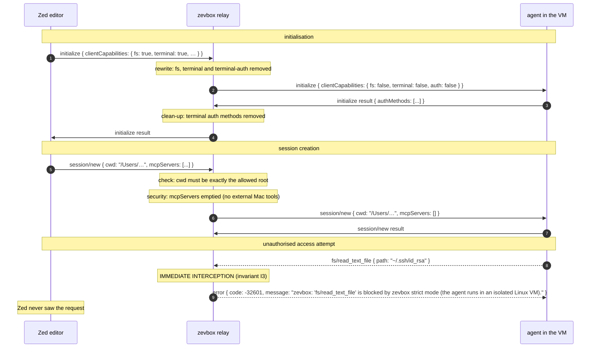
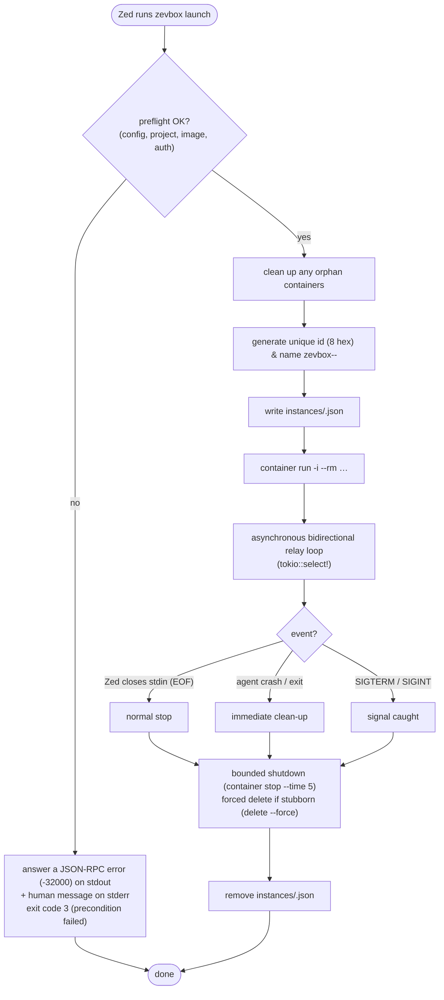
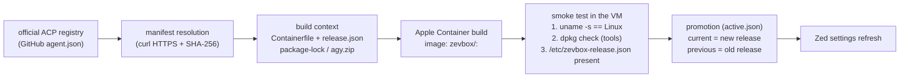
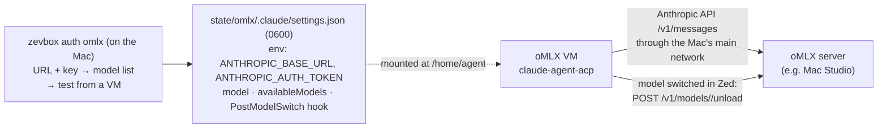

# zevbox — Architecture, Operation and Security

**English** · [Français](fr/ARCHITECTURE.md)

This document gives a detailed overview of **zevbox**: its design choices, its security model,
and how the ACP relay and the Apple Container micro-VMs work together.

---

## 1. Context and problem

### The problem with AI agents in the editor
When an editor such as **Zed** integrates an AI agent through ACP (*Agent Client Protocol* —
e.g. Claude Code or Google Antigravity; zevbox also offers oMLX, Claude Code on a local model server), the agent normally runs directly on your Mac with all
of your user privileges. It can therefore:

- read your SSH private keys (`~/.ssh/id_rsa`), cloud credentials (`~/.aws`,
  `~/.config/gcloud`), keychain-backed secrets and environment variables;
- run arbitrary commands on the host (`rm -rf`, uncontrolled installs, unsolicited network
  access);
- modify personal files unrelated to the project you are working on.

### The solution: zevbox
zevbox fully isolates the agent inside an ephemeral **Apple Container Linux arm64 micro-VM**,
and places a **filtering relay** between Zed and the VM that inspects and neutralises every
potentially dangerous call.

---

## 2. Why Apple Container micro-VMs?

Choosing **Apple Container micro-VMs** is central to zevbox's confinement strategy. It helps to
understand the difference between traditional containers, classic virtual machines and Apple's
native micro-VMs.

### 2.1 Isolation technologies compared

```mermaid
flowchart TD
    subgraph HostExec ["1. Running directly on the host"]
        H1["AI agent"] --> H2["macOS kernel (XNU)"]
        H2 --> H3["direct access to ALL your personal files (~/.ssh, …)"]
    end

    subgraph ClassicDocker ["2. Classic Linux containers (Docker on Linux)"]
        D1["agent in a container"] --> D2["shared Linux kernel (namespaces / cgroups)"]
        D2 -.->|"container escape if kernel bug (CVE)"| D3["host compromised"]
    end

    subgraph AppleVM ["3. Apple Container micro-VM (zevbox)"]
        A1["agent in a micro-VM"] --> A2["dedicated guest Linux kernel in RAM"]
        A2 --> A3["hardware hypervisor boundary (Apple Virtualization.framework / ARM EL2)"]
        A3 --> A4["macOS kernel protected (nothing outside the 2 mounts)"]
    end
```

### 2.2 Five decisive advantages

#### 1. Hardware-enforced hypervisor boundary
- **Classic container (Linux)**: isolation relies on OS software features (`namespaces`,
  `cgroups`, `chroot`). Agent and host share the *same* kernel; a kernel vulnerability lets an
  attacker escape straight to the host.
- **Apple Container (macOS)**: each container is a **real, separate micro virtual machine**
  driven by Apple's native `Virtualization.framework`. Separation is enforced in silicon by the
  Apple Silicon virtualisation extensions (ARM EL2). Even an attacker with full `root` who
  corrupts the Linux kernel inside the micro-VM still faces the macOS hypervisor boundary.

#### 2. Instant start-up
- A traditional VM (UTM, Parallels, VirtualBox) emulates a full motherboard, loads a BIOS/UEFI,
  boots a heavy OS, and takes 15–30 seconds while pinning gigabytes of RAM.
- Apple Container micro-VMs boot a minimal Linux kernel directly in memory in **well under a
  second**. From inside Zed, starting the agent feels instantaneous.

#### 3. Native, fast file sharing with `virtiofs`
- Docker Desktop on Mac has long suffered from heavy I/O latency on host files (osxfs / gRPC
  FUSE bridges).
- Apple Container uses **`virtiofs`**, integrated in both the macOS and guest Linux kernels
  through shared memory. The agent reads and writes your project at close to native SSD speed.

#### 4. Exact permission preservation (`host_uid` / `host_gid`)
- With classic Docker, files written by a container often end up owned by `root`, locking you
  out of your own files on the Mac.
- zevbox maps your macOS UID/GID (`id -u` / `id -g`, e.g. 501:20) into the VM. Files created or
  modified by the agent immediately belong to your macOS user — no root-squash, no permission
  fixes.

#### 5. Full ephemerality (`--rm`) and dropped capabilities (`--cap-drop ALL`)
- The micro-VM runs on a temporary overlay. As soon as Zed closes the session the VM is
  destroyed: temporary files, build scripts and artefacts outside the project vanish without
  polluting your Mac.
- The container also starts with `--cap-drop ALL`: even `root` inside the VM has no special
  Linux capability (`CAP_SYS_ADMIN`, `CAP_NET_ADMIN`, …).

---

## 3. Overall architecture

Four key components:

1. **Supervisor and CLI (`src/supervisor.rs`, `src/cli/`)**
   - manages the micro-VM lifecycle through the Apple Container CLI (`container`);
   - runs the *preflight* checks before any launch;
   - guarantees a clean, *bounded shutdown* when Zed exits.
2. **ACP relay (`src/relay/mod.rs`, `src/relay/policy.rs`)**
   - inspects every JSON-RPC frame between Zed and the agent;
   - applies a strict, zero-trust policy expressed as pure, audited functions.
3. **Container engine (`src/container.rs`)**
   - builds the exact `container` CLI invocation;
   - drops all Linux capabilities (`--cap-drop ALL`), forbids a TTY for the ACP container, and
     maps the host UID/GID.
4. **Release manager (`src/release.rs`)**
   - fetches and verifies the official ACP registry manifests;
   - builds Linux images from a Debian base (`node:22-bookworm-slim`) pinned by SHA-256 digest;
   - runs *smoke tests* before promoting a release.

---

## 4. The security core: the relay policy

ACP lets the agent ask the editor to act on the machine (for example `fs/read_text_file`,
`terminal/create`). zevbox's policy removes that attack surface entirely.

### What the relay does with each message

### Verdict table

| Direction | ACP method | zevbox action | Reason |
|---|---|---|---|
| **Client → Agent** | `initialize` | **Rewritten** | disables every host capability (`fs=false`, `terminal=false`). |
| **Client → Agent** | `session/new` | **Rewritten** | forces `cwd` to the project root, empties `mcpServers`. |
| **Agent → Client** | `fs/read_text_file`, `fs/write_text_file` | **Blocked** (error -32601) | the agent must not read/write the Mac through Zed. |
| **Agent → Client** | `terminal/create`, `terminal/exec` | **Blocked** (error -32601) | the agent must not open a terminal on the Mac. |
| **Agent → Client** | `authenticate` (terminal) | **Blocked** | no authentication code runs on the host. |
| **Agent → Client** | `session/update`, notifications | **Forwarded** | lets the agent stream its answers to Zed. |

---

## 5. Session lifecycle

The supervisor guarantees that no orphan container stays alive, even if Zed crashes or is
force-quit.

---

## 6. Versioning: releases, build and rollback

zevbox uses an immutable release pipeline: each agent version gets a unique timestamped id
(`<agent>-YYYYMMDD-HHMMSS`) and a lock file (`lock.json`).

If a regression shows up, `zevbox rollback --agent <agent>` swaps `current` and `previous` in
`active.json` in under a second, with no rebuild.

---

## 7. Claude vs Antigravity: two authentication flows

Why does Claude sign in from inside the VM while Antigravity needs a host-side step?

```mermaid
flowchart TD
    subgraph ClaudeAuth ["Claude Code (in the VM)"]
        C1["zevbox auth claude"] --> C2["interactive container: container run -it …"]
        C2 --> C3["claude-agent-acp --cli auth login"]
        C3 --> C4["user pastes the URL, then the code, in the terminal"]
        C4 --> C5["token saved in state/claude/.claude/.credentials.json"]
        C5 --> C6["marker detected: AUTHENTICATED ✅"]
    end

    subgraph AgyAuth ["Antigravity's native flow (does not work from a VM)"]
        A1["ACP method authenticate(oauth-personal)"] --> A2["agy_acp_server.par starts an HTTP server\non http://127.0.0.1:<random port>/ inside the VM"]
        A2 --> A3["link opened in the Mac browser"]
        A3 --> A4["Google redirects the browser to http://127.0.0.1:<random port>/"]
        A4 --> A5{"where is the port listening?"}
        A5 -- "the browser looks on the Mac" --> A6["Connection refused ❌\n(the port only exists inside the VM)"]
        A5 -. "publish the port (--publish)?" .-> A7["FORBIDDEN by policy (I1, §8.2)"]
    end
```

zevbox therefore runs Antigravity's OAuth 2.0 **PKCE flow on the host** (`zevbox auth
antigravity`): a one-shot HTTP listener on `127.0.0.1:<random port>` receives Google's redirect,
the code is exchanged for tokens, and the result is written to
`state/antigravity/.gemini/antigravity-acp/{settings.json,acp_token.json}` (`0600`) — the
directory the agent sees as `/home/agent/.gemini/antigravity-acp/` inside the VM. No port is
published on the VM and the macOS keychain is never touched.

| | Claude Code | Google Antigravity |
|---|---|---|
| **ACP component** | npm package (`@agentclientprotocol/claude-agent-acp`) | hermetic Python executable archive (`agy_acp_server.par`) |
| **Authentication** | interactive console CLI (`--cli auth login`) in the VM | OAuth 2.0 PKCE run by zevbox on the Mac |
| **Works from a network-isolated VM** | **yes** (no local server needed) | **no** — hence the host-side flow |
| **Token location (in the VM)** | `/home/agent/.claude/.credentials.json` | `/home/agent/.gemini/antigravity-acp/acp_token.json` |

### 7b. oMLX: the Claude adapter on a local model server

`zevbox · oMLX` (optional) is not a new adapter. It is **the Claude adapter**, built from the
same Containerfile stage into its own image (`zevbox/omlx:<id>`), with its own state folder
(`state/omlx`, mounted at `/home/agent`). Nothing is shared with the Claude agent and its
subscription.

- **Configuration**: Claude Code reads the server URL and key from the `env` block of its own
  settings file, so no claude.ai sign-in happens. The key never appears on a command line, in a
  `container run -e`, or in a log (I9); `zevbox auth omlx` passes it to `curl` on stdin.
- **Models**: `availableModels` holds the server's model ids, which become the entries of
  Zed's model picker. The default is the smallest model (`ANTHROPIC_DEFAULT_MODEL`); Claude
  Code's small background requests always use the smallest model too (`ANTHROPIC_SMALL_FAST_MODEL`).
  No other model slot is set (`ANTHROPIC_MODEL`, `model`, opus/sonnet/haiku): each would add an
  entry that lends its name to every server model with a similar id, so Zed would show wrong
  names. The aliases opus/sonnet/haiku fall back to the default model.
- **Unloading**: a `PostModelSwitch` hook runs **inside the VM** and asks the server to unload
  the model just left — except the smallest one, which the background requests would reload at
  once. The relay is unchanged and `launch` still does no network access (I10).
- **Network**: the VMs only go out through the Mac's main interface (the default route). A server
  reached by a direct cable is invisible to them; `zevbox auth omlx` and `zevbox doctor` test the
  server from a VM and say so.
- **Opt-in**: `update` and `setup` without `--agent` leave oMLX alone until it is installed.

---

## 8. The 13 security invariants

Checked automatically on every build (`scripts/check-invariants.sh` and the test suite) and
never relaxed:

1. **I1 — Exactly two mounts**: the project directory and the agent's state directory. Personal folders (`$HOME`, `~/.ssh`, `~/.gemini`, …) are never mounted.
2. **I2 — Projects in allowed zones**: the canonical project must be strictly inside the home folder (not `~/Library`, not a hidden `~/.…` folder) or on a disk under `/Volumes`; picking a zevbox agent in Zed is the consent, there is no project list.
3. **I3 — Host filesystem and terminal blocked**: no `fs/*` or `terminal/*` call ever reaches Zed.
4. **I4 — Bidirectional filtering by id**: only listed methods are routed; responses are matched to their pending request.
5. **I5 — Confined working directory**: `cwd` is always the project root.
6. **I6 — Pure JSON-RPC on stdout**: nothing but strict JSON-RPC is written to stdout, to keep Zed stable.
7. **I7 — Zero host shell**: `/bin/sh`, `bash` or `zsh` are never spawned on the Mac.
8. **I8 — Surgical container targeting**: `stop` and `delete` only target verified containers with the `zevbox-` prefix; `--all` is banned.
9. **I9 — Private logs**: no token, password or message content is ever logged.
10. **I10 — No build or network at launch**: `launch` is instant and downloads nothing.
11. **I11 — Rust robustness**: zero `unwrap()`, `expect()` or `panic!()` in production code (`src/`).
12. **I12 — zevbox isolation**: zevbox's own binary and internal files are never mounted into a container.
13. **I13 — Project files the Mac would run**: in the ACP container, `<project>/.zed` is masked by a tmpfs and an existing `<project>/.git` is read-only; `guard.rs` starts watching the project before the container starts (a `.zed` that is a file or a link is refused at launch) and stops the agent if a `.git` appears or changes elsewhere. Zed runs programs named in `.zed/settings.json` and git filters by itself (see [EXP-01](experiments/EXP-01-resultats.md)).
