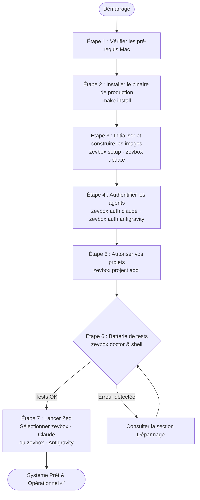
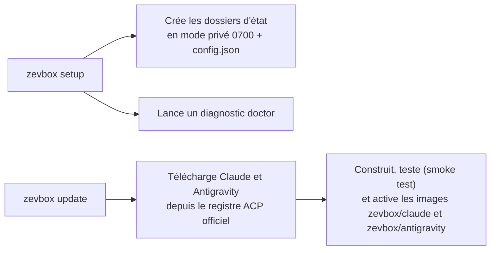
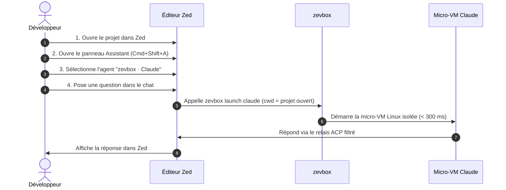

# zevbox — Manuel Utilisateur

Ce manuel vous guide pas à pas pour installer, configurer, vérifier et utiliser **`zevbox`** avec l'éditeur **Zed** sur macOS.

À la fin de ce guide, vous aurez la certitude absolue que votre environnement est 100 % opérationnel, sécurisé et prêt à l'emploi.

---

## 1. Parcours Utilisateur Global

Voici les étapes que vous allez suivre :



---

## 2. Pré-requis Système

Avant de commencer, vérifiez que vous disposez des éléments suivants :

1. **Mac avec puce Apple Silicon** (M1, M2, M3, M4) sous macOS 13 ou supérieur.
2. **Apple Container CLI** (`container` version ≥ 1.5.0) installé et actif :
   ```bash
   container system status
   ```
   *Le statut doit afficher `running: true`.*
3. **Rust & Cargo** installés sur votre Mac (dans `/opt/homebrew/opt/rustup/bin` ou `~/.cargo/bin`).
4. **L'éditeur Zed** installé sur votre Mac.

---

## 3. Installation et Configuration Pas-à-Pas

### Étape 1 : Vérifier votre PATH macOS
Pour pouvoir lancer `zevbox` de n'importe où dans votre terminal, assurez-vous que `~/.local/bin` fait partie de votre `PATH`.

Ajoutez cette ligne dans votre fichier de configuration shell (`~/.zshrc`) si ce n'est pas déjà fait :
```bash
export PATH="$HOME/.local/bin:/opt/homebrew/opt/rustup/bin:$HOME/.cargo/bin:$PATH"
```
Rechargez ensuite votre terminal :
```bash
source ~/.zshrc
```

---

### Étape 2 : Compiler et Installer le Binaire
Depuis le répertoire racine de `zevbox` (`~/code/zevbox`) :

```bash
make install
```

**Ce que fait cette commande :**
- Exécute les contrôles de formatage, les linters de sécurité et la suite complète de tests (`make check`).
- Compile une version release optimisée en Rust.
- Installe le binaire final dans `~/.local/bin/zevbox`.

**Vérification immédiate :**
```bash
zevbox --help
```
*Vous devez voir s'afficher la liste des 16 commandes du projet.*

---

### Étape 3 : Initialiser l'Environnement et Construire les Images des Agents

> **Raccourci (R2)** : `zevbox auth <agent>` (étape 4) fait `init` puis `update` pour cet agent si nécessaire. Cette étape n'est utile que pour tout préparer d'un coup ou pour mettre à jour les images ; vous pouvez la sauter.

```bash
zevbox setup
zevbox update
```



**Ce que font ces commandes :**
1. `setup` crée les répertoires d'état sécurisés (`0700`) et `config.json`, construit les releases manquantes (comme `update`), propose l'authentification de chaque agent non connecté (uniquement dans un terminal ; sinon elle affiche la commande `zevbox auth <agent>`), démarre le runtime Apple Container s'il est arrêté, exécute `doctor` et affiche un résumé par agent. Idempotente : relancée, elle ne reconstruit rien.
2. `update` construit une image par agent (≈ 1 à 3 minutes chacune, réseau requis) et la promeut en release active. À relancer quand `zevbox update --check` signale une nouvelle version.

> **Remarque** : `zevbox setup` n'enregistre aucun projet si vous ne lui passez pas de chemin. C'est l'étape 5 qui le fait. Vous pouvez aussi tout faire d'un coup avec `zevbox setup /chemin/du/projet` (les images sont construites par `setup` si elles manquent).

---

### Étape 4 : Authentifier les Agents (une seule fois ; construit l'image au premier passage)
Les agents s'exécutent dans une micro-VM avec leur propre dossier d'état (`state/<agent>/`, monté sur `/home/agent` dans la VM). Vous connectez chaque compte une seule fois ; les jetons persistent d'une session à l'autre.

#### 4a. Claude

```bash
zevbox auth claude
```

**Déroulement :**
1. Une micro-VM éphémère démarre en mode interactif dans votre terminal. Elle ne monte aucun de vos dossiers : un dossier vide jetable et l'état de l'agent seulement.
2. Claude affiche `Opening browser to sign in…` puis une URL `https://claude.com/cai/oauth/authorize?…`. **Le navigateur ne s'ouvre pas tout seul** (le processus tourne dans la VM) : copiez l'URL dans votre navigateur.
3. Connectez-vous avec votre compte Claude (Pro / Team / Max) et autorisez l'accès ; collez le code affiché dans le terminal à l'invite `Paste code here if prompted >`.
4. `Login successful.` : le jeton est enregistré dans `state/claude/.claude/.credentials.json` (`0600`).

**Modèle par défaut.** Avant de lancer la VM, `auth` écrit `state/claude/.claude/settings.json` (`{"model": "…"}`, `0600`) s'il n'existe pas : le `model` de votre `~/.claude/settings.json` (lu seul, jamais monté) ou `fable`. Sans cela, Claude démarre sur Haiku 4.5, qui n'a pas le mode Auto. Pour changer de modèle, éditez ce fichier ; `auth` ne le réécrit jamais s'il existe.

#### 4b. Antigravity (Gemini, compte Google personnel)

```bash
zevbox auth antigravity
```

**Déroulement :**
1. zevbox ouvre un petit serveur HTTP **sur votre Mac** (`127.0.0.1`, port aléatoire — aucun port n'est publié sur la micro-VM) et affiche l'URL de connexion Google. Si le navigateur ne s'ouvre pas, copiez-la. Zevbox attend le retour de Google pendant 5 minutes.
2. Choisissez votre compte **Google AI Pro / One AI Premium** et cliquez sur **Autoriser**.
3. Le navigateur affiche « Authentification Google réussie ! » ; le terminal affiche `Exchanging authorization code with Google...` puis `Google Antigravity authenticated successfully.`
4. Les fichiers `settings.json` et `acp_token.json` sont écrits dans `state/antigravity/.gemini/antigravity-acp/` (`0600`). Le trousseau macOS n'est jamais sollicité.

**Vérification immédiate :**
```bash
zevbox auth claude --status
zevbox auth antigravity --status
```
*Chaque commande doit renvoyer exactement :*
```text
authenticated
```

---

### Étape 5 : Autoriser Vos Projets
zevbox ne monte jamais un dossier dans une micro-VM s'il n'a pas été explicitement autorisé (invariant I2). Pour chaque projet que vous voulez ouvrir avec un agent :

```bash
zevbox project add /chemin/absolu/du/projet
```

**Ce que fait cette commande :**
1. Valide que le chemin est sain (interdit `/`, `$HOME` et ses parents, les dossiers système, les dossiers de zevbox).
2. L'ajoute à la liste blanche `config.json`.
3. S'assure que les deux entrées **`zevbox · Claude`** et **`zevbox · Antigravity`** sont présentes dans Zed (`~/.config/zed/settings.json`, sauvegarde dans `backups/` si quelque chose change). Pas besoin de redémarrer Zed.

Répétez la commande pour chaque projet. `zevbox project list` affiche la liste ; `zevbox project remove <chemin>` retire un projet (les entrées Zed restent : elles ne dépendent pas des projets).

> **Pourquoi seulement deux entrées ?** Les serveurs d'agents de Zed sont un réglage global, visible depuis tous les projets. Les entrées `zevbox · …` n'embarquent donc aucun chemin : au lancement, zevbox prend le dossier ouvert dans Zed (premier dossier racine) et vérifie qu'il est dans la liste blanche. Dans un dossier non autorisé, Zed affiche `… is not an allowed project. Fix: run 'zevbox project add …'` (voir Dépannage, problème 2).

---

## 4. Batterie de Tests : Confirmer que Tout Est 100 % Opérationnel

Avant même d'ouvrir Zed, exécutez ces 3 tests simples pour vous assurer que tout fonctionne parfaitement :

### Test 1 : Le Diagnostic Automatique Global
Lancez la commande de contrôle :
```bash
zevbox doctor
```

**Résultat attendu :**
Tous les voyants doivent être à `[OK  ]` :
```text
[OK  ] config               — config.json is valid
[OK  ] container_binary     — Apple Container 1.5.0 (arm64)
[OK  ] system_status        — Apple Container runtime is running
[OK  ] architecture         — host architecture is arm64
[OK  ] project:...          — project directory exists
[OK  ] agent:claude         — release claude-... (authenticated)
[OK  ] agent:antigravity    — release antigravity-... (authenticated)
[OK  ] permissions          — stateRoot is 0700
```
> Si tous les indicateurs sont à `[OK  ]`, votre installation est saine.

---

### Test 2 : Test d'Isolation en Direct (Shell dans la Micro-VM)
Pour prouver matériellement que l'agent est bien cloisonné et qu'il ne peut pas toucher à votre Mac :

Lancez un shell interactif dans la VM :
```bash
zevbox shell claude
```

Vous devez voir s'afficher la bannière de sécurité :
```text
zevbox Linux shell — agent=claude project=~/code/zevbox release=claude-... (changes outside the project are discarded on exit)
```

Dans ce shell Linux, tapez successivement les 4 commandes de test suivantes :

```bash
# 1. Vérifier le noyau : vous êtes bien dans une VM Linux, pas sous macOS !
uname -s
# Doit renvoyer : Linux

# 2. Vérifier l'utilisateur interne
whoami
# Doit renvoyer : agent

# 3. Vérifier que vous êtes bien positionné à la racine de votre projet
pwd
# Doit renvoyer le chemin exact de votre projet

# 4. LE TEST ULTIME DE SÉCURITÉ : Tenter de voir vos clés SSH du Mac
ls -la ~/.ssh
# Doit renvoyer : No such file or directory (votre Mac est 100 % invisible)

# 5. Quitter le shell
exit
```
Dès que vous tapez `exit`, la micro-VM est anéantie et tous les fichiers temporaires créés hors du projet sont effacés.

---

### Test 3 : Vérifier la Configuration de Zed
Vérifiez que Zed a bien reçu les entrées de vos projets :

```bash
grep -C 4 "zevbox · " ~/.config/zed/settings.json
```

**Résultat attendu :**
Exactement deux blocs, quel que soit le nombre de projets autorisés :
```json
    "zevbox · Claude": {
      "type": "custom",
      "command": "~/.local/bin/zevbox",
      "args": ["launch", "claude"],
      "env": {}
    },
    "zevbox · Antigravity": {
      "type": "custom",
      "command": "~/.local/bin/zevbox",
      "args": ["launch", "antigravity"],
      "env": {}
    }
```

---

## 5. Utilisation Quotidienne dans Zed

Tout est configuré ! Vous pouvez maintenant utiliser Claude ou Antigravity dans Zed en toute sérénité (le schéma montre Claude ; Antigravity est identique) :



### La Marche à Suivre dans Zed :

1. **Ouvrez un projet autorisé dans Zed** (un seul dossier racine par fenêtre) :
   ```bash
   zed ~/code/demo-app
   ```
2. **Ouvrez le panneau Assistant / Agent** :
   - Raccourci clavier : `Cmd + Shift + A` (ou menu *View > Toggle Assistant Panel*).
3. **Sélectionnez le serveur d'agent** :
   - En haut du panneau, menu « New Thread » / choix de l'agent.
   - Choisissez **`zevbox · Claude`** ou **`zevbox · Antigravity`** : ce sont les deux seules entrées zevbox, elles s'appliquent au projet ouvert.
4. **Faites un test dans le chat de Zed** :
   - Tapez ce prompt de validation :
     > *"Peux-tu me dire quel est ton système d'exploitation et lister les fichiers du dossier courant ?"*
   - L'agent doit confirmer qu'il tourne sous **Linux arm64**, et lister fidèlement les fichiers de votre projet sans jamais avoir accès au reste de votre Mac.

---

## 6. Bonnes Pratiques : Ce qu'il faut faire / Ce qu'il ne faut PAS faire

| ✅ Ce qu'il faut faire | ❌ Ce qu'il ne faut PAS faire |
|---|---|
| **Toujours ajouter vos projets via `zevbox project add <path>`** pour les déclarer dans la liste blanche de sécurité. | **Ne jamais tenter de monter `$HOME` direct, la racine `/` ou des dossiers système** (rejeté immédiatement par l'invariant I2). |
| **Utiliser `zevbox tools add <paquet>`** si vous voulez que l'agent dispose d'outils Linux supplémentaires (p. ex. `ripgrep`, `clang`, `jq`). | **Ne jamais essayer d'installer des paquets avec `sudo apt` directement pendant une session** (la VM est éphémère et les droits root sont délestés). |
| **Lancer `zevbox stop`** en fin de journée pour libérer toutes les instances d'arrière-plan. | **Ne jamais lancer `container stop --all` à la main** (cela arrêterait vos conteneurs personnels hors zevbox). |
| **Faire un `zevbox doctor`** en cas de comportement inattendu pour voir immédiatement la cause. | **Ne jamais modifier à la main les clés `zevbox · ...` dans les réglages de Zed** (utilisez `zevbox zed install` ou `zevbox zed uninstall`). |

---

## 7. Guide de Dépannage Rapide

### Problème 1 : Zed affiche `Claude is not authenticated` (ou `Antigravity is not authenticated`)
- **Cause** : Le jeton de l'agent n'est pas encore présent dans son dossier d'état.
- **Solution** : Ouvrez un terminal et lancez `zevbox auth claude` (ou `zevbox auth antigravity`), puis vérifiez avec `zevbox auth <agent> --status`.

---

### Problème 2 : Zed affiche `... is not an allowed project. Fix: run 'zevbox project add ...'`
- **Cause** : Le dossier ouvert dans Zed n'est pas dans la liste blanche de `zevbox`.
- **Solution** : Dans votre terminal, ajoutez le dossier (pas besoin de redémarrer Zed, relancez juste le thread) :
  ```bash
  zevbox project add /chemin/vers/ce/dossier
  ```

---

### Problème 3 : Zed affiche `zevbox: this agent is bound to <A>; this session asked for <B>`
- **Cause** : La session Zed demande un dossier (`<B>`) différent de celui où l'agent a été lancé (`<A>`) — en pratique un espace de travail Zed avec plusieurs dossiers racines.
- **Solution** : Ouvrez un seul dossier racine par fenêtre Zed.

---

### Problème 3b : Zed affiche `Auto mode unavailable: the selected model does not support Auto mode`
- **Cause** : le modèle par défaut de Claude dans la VM est Haiku 4.5 (pas de mode Auto) ; Zed applique le mode avant le modèle.
- **Solution** : `zevbox doctor` signale `no default model` ; lancez `zevbox auth claude` ou écrivez `{"model": "fable"}` dans `state/claude/.claude/settings.json` (voir étape 4a), puis ouvrez un nouveau thread.

---

### Problème 4 : Zed affiche `Apple Container system is not running`
- **Cause** : Le service de virtualisation Apple Container est arrêté sur votre Mac.
- **Solution** : Démarrez-le avec la commande native :
  ```bash
  container system start
  ```

---

### Problème 5 : Vous voulez revenir à une version précédente d'un agent
- **Cause** : Une mise à jour récente de Claude dans le registre a introduit un comportement indésirable.
- **Solution** : Utilisez le rollback instantané :
  ```bash
  zevbox rollback --agent claude
  ```

---

## 8. Résumé des Commandes Indispensables

| Action | Commande exacte |
|---|---|
| Diagnostiquer l'état du système | `zevbox doctor` |
| Construire / mettre à jour les images des agents | `zevbox update` |
| Se connecter à Claude / à Google (Antigravity) | `zevbox auth claude` / `zevbox auth antigravity` |
| Vérifier le statut de connexion | `zevbox auth claude --status` / `zevbox auth antigravity --status` |
| Ouvrir un shell Linux de test | `zevbox shell claude` |
| Ajouter un nouveau projet | `zevbox project add /mon/projet` |
| Ajouter un outil Linux dans la VM | `zevbox tools add ripgrep` |
| Consulter les logs récents | `zevbox logs` |
| Arrêter les VM actives | `zevbox stop` |
| Nettoyer les fichiers obsolètes | `zevbox clean --images` |
