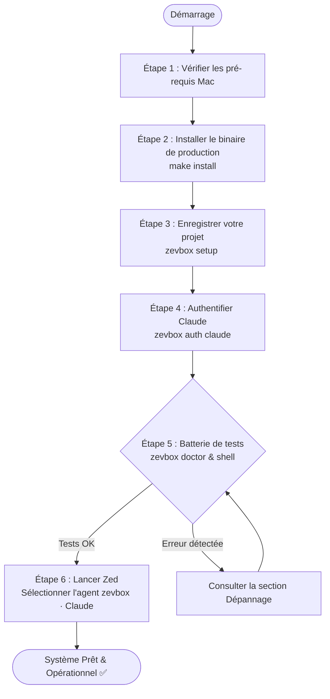
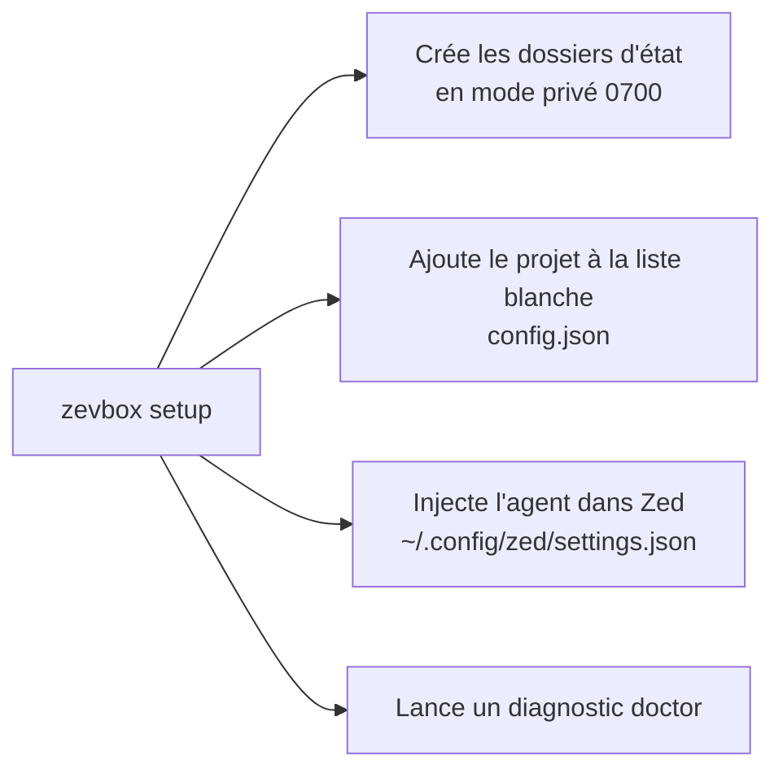
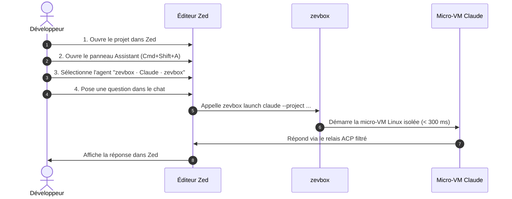

# zevbox — Manuel Utilisateur

Ce manuel vous guide pas à pas pour installer, configurer, vérifier et utiliser **`zevbox`** avec l'éditeur **Zed** sur macOS.

À la fin de ce guide, vous aurez la certitude absolue que votre environnement est 100 % opérationnel, sécurisé et prêt à l'emploi.

---

## 1. Parcours Utilisateur Global

Voici les étapes que vous allez suivre :



---

## 2. Pré-requis Système

Avant de commencer, vérifiez que vous disposez des éléments suivants :

1. **Mac avec puce Apple Silicon** (M1, M2, M3, M4) sous macOS 13 ou supérieur.
2. **Apple Container CLI** (`container` version ≥ 1.5.0) installé et actif :
   ```bash
   container system status
   ```
   *Le statut doit afficher `running: true`.*
3. **Rust & Cargo** installés sur votre Mac (dans `/opt/homebrew/opt/rustup/bin` ou `~/.cargo/bin`).
4. **L'éditeur Zed** installé sur votre Mac.

---

## 3. Installation et Configuration Pas-à-Pas

### Étape 1 : Vérifier votre PATH macOS
Pour pouvoir lancer `zevbox` de n'importe où dans votre terminal, assurez-vous que `~/.local/bin` fait partie de votre `PATH`.

Ajoutez cette ligne dans votre fichier de configuration shell (`~/.zshrc`) si ce n'est pas déjà fait :
```bash
export PATH="$HOME/.local/bin:/opt/homebrew/opt/rustup/bin:$HOME/.cargo/bin:$PATH"
```
Rechargez ensuite votre terminal :
```bash
source ~/.zshrc
```

---

### Étape 2 : Compiler et Installer le Binaire
Depuis le répertoire racine de `zevbox` (`~/code/zevbox`) :

```bash
make install
```

**Ce que fait cette commande :**
- Exécute les contrôles de formatage, les linters de sécurité et la suite complète de 167 tests.
- Compile une version release optimisée en Rust.
- Installe le binaire final dans `~/.local/bin/zevbox`.

**Vérification immédiate :**
```bash
zevbox --help
```
*Vous devez voir s'afficher la liste des 15 commandes du projet.*

---

### Étape 3 : Initialiser l'Environnement et Enregistrer Votre Projet
Exécutez la commande d'onboarding `setup` en lui passant le chemin absolu de votre projet :

```bash
zevbox setup ~/code/zevbox
```

*(Si vous souhaitez enregistrer un autre dossier de travail plus tard, remplacez simplement ce chemin).*



**Ce que fait cette commande automatiquement :**
1. Crée les répertoires d'état sécurisés avec des permissions strictes `0700`.
2. Valide que le chemin du projet est sain (interdit le dossier racine ou `$HOME`).
3. Enregistre le projet dans `config.json`.
4. Injecte automatiquement le serveur d'agent `zevbox · Claude · <nom_projet>` dans votre fichier de réglages Zed (`~/.config/zed/settings.json`) tout en créant une sauvegarde de sécurité dans `backups/`.
5. Exécute un premier passage de `doctor`.

---

### Étape 4 : Authentifier l'Agent Claude
Les agents IA s'exécutent dans une micro-VM avec leur propre dossier d'état. Vous devez connecter votre compte Claude une seule fois :

```bash
zevbox auth claude
```

**Déroulement de l'action :**
1. Une micro-VM éphémère démarre en mode interactif dans votre terminal.
2. Claude affiche une invite ou un lien web de connexion Anthropic :
   - Cliquez sur le lien ou copiez-le dans votre navigateur.
   - Connectez-vous avec votre compte Claude (Claude Pro / Team / Max).
   - Autorisez l'accès.
3. Le jeton de session est enregistré de façon étanche dans `~/.local/share/zevbox/state/claude/` (ou `Application Support/zevbox/state/claude/`).
4. La commande se termine et vous redonne la main sur votre terminal.

**Vérification immédiate du statut :**
```bash
zevbox auth claude --status
```
*Confirmation attendue : la commande doit renvoyer exactement :*
```text
authenticated
```

---

## 4. Batterie de Tests : Confirmer que Tout Est 100 % Opérationnel

Avant même d'ouvrir Zed, exécutez ces 3 tests simples pour vous assurer que tout fonctionne parfaitement :

### Test 1 : Le Diagnostic Automatique Global
Lancez la commande de contrôle :
```bash
zevbox doctor
```

**Résultat attendu :**
Tous les voyants doivent être à `[OK  ]` :
```text
[OK  ] config               — config.json is valid
[OK  ] container_binary     — Apple Container 1.5.0 (arm64)
[OK  ] system_status        — Apple Container runtime is running
[OK  ] architecture         — host architecture is arm64
[OK  ] project:...          — project directory exists
[OK  ] agent:claude         — release claude-... (authenticated)
[OK  ] permissions          — stateRoot is 0700
```
> Si tous les indicateurs sont à `[OK  ]`, votre installation est saine.

---

### Test 2 : Test d'Isolation en Direct (Shell dans la Micro-VM)
Pour prouver matériellement que l'agent est bien cloisonné et qu'il ne peut pas toucher à votre Mac :

Lancez un shell interactif dans la VM :
```bash
zevbox shell claude
```

Vous devez voir s'afficher la bannière de sécurité :
```text
zevbox Linux shell — agent=claude project=~/code/zevbox release=claude-... (changes outside the project are discarded on exit)
```

Dans ce shell Linux, tapez successivement les 4 commandes de test suivantes :

```bash
# 1. Vérifier le noyau : vous êtes bien dans une VM Linux, pas sous macOS !
uname -s
# Doit renvoyer : Linux

# 2. Vérifier l'utilisateur interne
whoami
# Doit renvoyer : agent

# 3. Vérifier que vous êtes bien positionné à la racine de votre projet
pwd
# Doit renvoyer le chemin exact de votre projet

# 4. LE TEST ULTIME DE SÉCURITÉ : Tenter de voir vos clés SSH du Mac
ls -la ~/.ssh
# Doit renvoyer : No such file or directory (votre Mac est 100 % invisible)

# 5. Quitter le shell
exit
```
Dès que vous tapez `exit`, la micro-VM est anéantie et tous les fichiers temporaires créés hors du projet sont effacés.

---

### Test 3 : Vérifier la Configuration de Zed
Vérifiez que Zed a bien reçu la configuration de l'agent :

```bash
grep -C 4 "zevbox · Claude" ~/.config/zed/settings.json
```

**Résultat attendu :**
Vous devez voir le bloc JSON suivant :
```json
    "zevbox · Claude · zevbox": {
      "type": "custom",
      "command": "~/.local/bin/zevbox",
      "args": ["launch", "claude", "--project", "~/code/zevbox"],
      "env": {}
    }
```

---

## 5. Utilisation Quotidienne dans Zed

Tout est configuré ! Vous pouvez maintenant utiliser Claude dans Zed en toute sérénité :



### La Marche à Suivre dans Zed :

1. **Ouvrez votre projet dans Zed** :
   ```bash
   zed ~/code/zevbox
   ```
2. **Ouvrez le panneau Assistant / Agent** :
   - Raccourci clavier : `Cmd + Shift + A` (ou menu *View > Toggle Assistant Panel*).
3. **Sélectionnez le serveur d'agent** :
   - En haut du panneau de discussion, cliquez sur le menu déroulant du choix du modèle / agent.
   - Vous devez voir apparaître l'option **`zevbox · Claude · zevbox`**. Cliquez dessus.
4. **Faites un test dans le chat de Zed** :
   - Tapez ce prompt de validation :
     > *"Peux-tu me dire quel est ton système d'exploitation et lister les fichiers du dossier courant ?"*
   - Claude doit vous confirmer qu'il tourne sous **Linux arm64**, et vous lister fidèlement les fichiers de votre projet sans jamais avoir accès au reste de votre Mac.

---

## 6. Bonnes Pratiques : Ce qu'il faut faire / Ce qu'il ne faut PAS faire

| ✅ Ce qu'il faut faire | ❌ Ce qu'il ne faut PAS faire |
|---|---|
| **Toujours ajouter vos projets via `zevbox project add <path>`** pour les déclarer dans la liste blanche de sécurité. | **Ne jamais tenter de monter `$HOME` direct, la racine `/` ou des dossiers système** (rejeté immédiatement par l'invariant I2). |
| **Utiliser `zevbox tools add <paquet>`** si vous voulez que l'agent dispose d'outils Linux supplémentaires (p. ex. `ripgrep`, `clang`, `jq`). | **Ne jamais essayer d'installer des paquets avec `sudo apt` directement pendant une session** (la VM est éphémère et les droits root sont délestés). |
| **Lancer `zevbox stop`** en fin de journée pour libérer toutes les instances d'arrière-plan. | **Ne jamais lancer `container stop --all` à la main** (cela arrêterait vos conteneurs personnels hors zevbox). |
| **Faire un `zevbox doctor`** en cas de comportement inattendu pour voir immédiatement la cause. | **Ne jamais modifier à la main les clés `zevbox · ...` dans les réglages de Zed** (utilisez `zevbox zed install` ou `zevbox zed uninstall`). |

---

## 7. Guide de Dépannage Rapide

### Problème 1 : Zed affiche `Claude is not authenticated`
- **Cause** : Le jeton de session Claude n'est pas encore initialisé dans son dossier d'état.
- **Solution** : Ouvrez un terminal et lancez :
  ```bash
  zevbox auth claude
  ```
  Vérifiez ensuite avec `zevbox auth claude --status`.

---

### Problème 2 : Zed affiche `... is not an allowed project`
- **Cause** : Vous avez ouvert dans Zed un dossier qui n'a pas été enregistré dans `zevbox`.
- **Solution** : Dans votre terminal, ajoutez le dossier :
  ```bash
  zevbox project add /chemin/vers/ce/dossier
  ```

---

### Problème 3 : Zed affiche `Apple Container system is not running`
- **Cause** : Le service de virtualisation Apple Container est arrêté sur votre Mac.
- **Solution** : Démarrez-le avec la commande native :
  ```bash
  container system start
  ```

---

### Problème 4 : Vous voulez revenir à une version précédente d'un agent
- **Cause** : Une mise à jour récente de Claude dans le registre a introduit un comportement indésirable.
- **Solution** : Utilisez le rollback instantané :
  ```bash
  zevbox rollback --agent claude
  ```

---

## 8. Résumé des Commandes Indispensables

| Action | Commande exacte |
|---|---|
| Diagnostiquer l'état du système | `zevbox doctor` |
| Se connecter à Claude | `zevbox auth claude` |
| Vérifier le statut de connexion | `zevbox auth claude --status` |
| Ouvrir un shell Linux de test | `zevbox shell claude` |
| Ajouter un nouveau projet | `zevbox project add /mon/projet` |
| Ajouter un outil Linux dans la VM | `zevbox tools add ripgrep` |
| Consulter les logs récents | `zevbox logs` |
| Arrêter les VM actives | `zevbox stop` |
| Nettoyer les fichiers obsolètes | `zevbox clean --images` |
