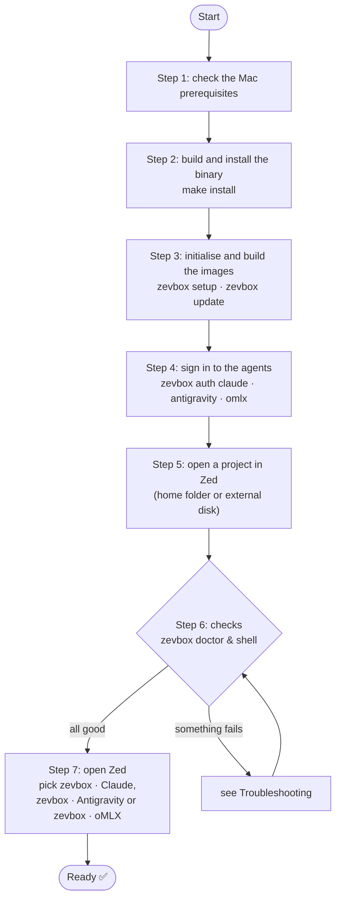
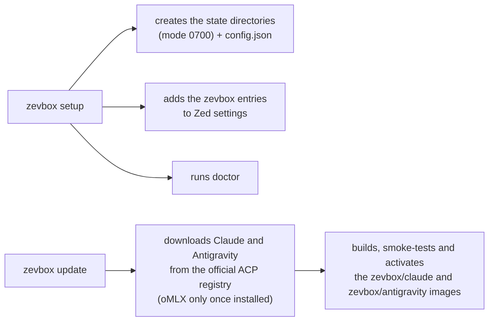
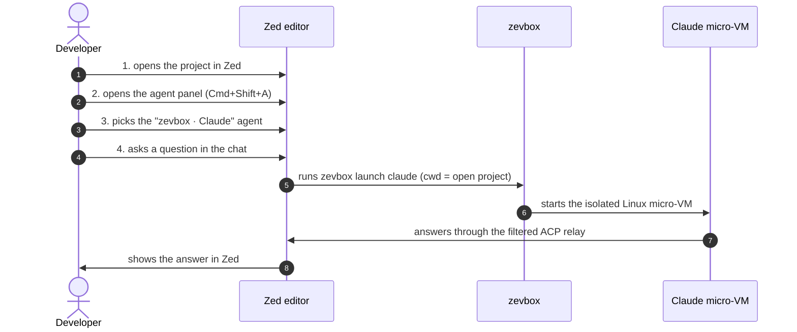

# zevbox — User Guide

**English** · [Français](fr/GUIDE_UTILISATEUR.md)

This guide walks you through installing, configuring, checking and using **zevbox** with the
**Zed** editor on macOS. At the end you will have verified, not assumed, that the agent runs in
an isolated Linux micro-VM and cannot see your Mac.

---

## 1. The journey at a glance



---

## 2. Prerequisites

1. **A Mac with Apple Silicon** (M1 or later) running a macOS version supported by Apple
   Container.
2. **Apple Container CLI** (`container` ≥ 1.5.0), installed and running:
   ```bash
   container system status
   ```
   *It must report `running: true`.*
3. **Rust and Cargo** (`/opt/homebrew/opt/rustup/bin` or `~/.cargo/bin`).
4. **The Zed editor.**

---

## 3. Step-by-step installation

### Step 1: check your PATH
So that `zevbox` can be run from anywhere, make sure `~/.local/bin` is on your `PATH`. Add this
to your shell configuration (`~/.zshrc`) if it is not already there:
```bash
export PATH="$HOME/.local/bin:/opt/homebrew/opt/rustup/bin:$HOME/.cargo/bin:$PATH"
```
then reload:
```bash
source ~/.zshrc
```

---

### Step 2: build and install the binary
From the root of the zevbox checkout (for example `~/code/zevbox`):

```bash
make install
```

**What it does:**
- runs formatting, lints and the full test suite (`make check`);
- builds an optimised release binary;
- installs it as `~/.local/bin/zevbox`.

**Check:**
```bash
zevbox --help
```
*You should see the list of the 14 commands (plus `help`).*

---

### Step 3: initialise the environment and build the agent images

> **Shortcut**: `zevbox auth <agent>` (step 4) runs `init` and then `update` for that agent when
> needed. This step is only useful to prepare everything at once or to update the images; you
> can skip it.

```bash
zevbox setup
zevbox update
```



**What they do:**
1. `setup` creates the private (`0700`) state directories and `config.json`, builds missing
   releases (like `update`), offers to authenticate each agent that is not signed in (terminal
   only; otherwise it prints the `zevbox auth <agent>` command to run), starts the Apple
   Container runtime if it is stopped, runs `doctor` and prints a per-agent summary. It is
   idempotent: run again, it rebuilds nothing.
2. `update` builds one image per agent (about 1–3 minutes each, network required) and promotes
   it as the active release. oMLX is optional: `update` and `setup` only handle it once
   `zevbox auth omlx` has installed it (`zevbox update --agent omlx` builds it by hand). Run
   `update` again whenever `zevbox update --check` reports a new version.

> **Note**: `zevbox setup` takes no argument and registers nothing: projects need no
> registration (Step 5). It builds the missing images, offers sign-in and configures Zed.

---

### Step 4: sign in to the agents (once; builds the image on first use)
Agents run in a micro-VM with their own state directory (`state/<agent>/`, mounted at
`/home/agent` in the VM). You sign in to each account once; tokens persist between sessions.

#### 4a. Claude

```bash
zevbox auth claude
```

**What happens:**
1. An ephemeral micro-VM starts interactively in your terminal. It mounts none of your folders:
   only an empty throwaway directory and the agent's state.
2. Claude prints `Opening browser to sign in…` followed by a
   `https://claude.com/cai/oauth/authorize?…` URL. **The browser does not open by itself** (the
   process runs inside the VM): paste the URL into your browser.
3. Sign in with your Claude account (Pro / Team / Max) and approve; paste the code shown into
   the terminal at `Paste code here if prompted >`.
4. `Login successful.` — the token is stored in `state/claude/.claude/.credentials.json`
   (`0600`).

**Default model.** Before starting the VM, `auth` writes `state/claude/.claude/settings.json`
(`{"model": "…"}`, `0600`) if it does not exist: the `model` from your own
`~/.claude/settings.json` (read only, never mounted) or `fable`. Without it Claude starts on
Haiku 4.5, which has no Auto mode. To change models, edit that file; `auth` never overwrites it.

#### 4b. Antigravity (Gemini, personal Google account)

```bash
zevbox auth antigravity
```

**What happens:**
1. zevbox starts a tiny HTTP server **on your Mac** (`127.0.0.1`, random port — no port is
   published on the micro-VM) and prints the Google sign-in URL. If the browser does not open,
   paste it. zevbox waits up to 5 minutes for Google to redirect back.
2. Choose your **Google AI Pro / One AI Premium** account and click **Allow**.
3. The browser shows a success page; the terminal prints
   `Exchanging authorization code with Google...` then
   `Google Antigravity authenticated successfully.`
4. `settings.json` and `acp_token.json` are written to
   `state/antigravity/.gemini/antigravity-acp/` (`0600`). The macOS keychain is never touched.

#### 4c. oMLX (optional: a local model server on your network)

If an [oMLX](https://github.com/jundot/omlx) server runs on another Mac (for example a Mac
Studio), zevbox can drive it with the Claude Code adapter, in its own VM and state folder (your
Claude subscription is not involved):

```bash
zevbox auth omlx --url http://192.168.1.8:8000
```

**What happens:**
1. The first time, zevbox builds the `zevbox/omlx` image (same adapter as Claude, 1–3 min).
2. It asks for the server's API key (hidden input; `echo "$KEY" | zevbox auth omlx --url …` also
   works) and lists the server's models **from the Mac**.
3. It writes `state/omlx/.claude/settings.json` (`0600`): the URL and key, the model list (the
   Zed model picker shows them), the default model (`--model <id>`, else the smallest one) and a
   hook that unloads the previous model on the server when you switch models in Zed. The
   smallest model is never unloaded: Claude Code keeps using it for small background requests.
   It also lists the models in `modelPicker`, so a switch in Zed is immediate (the first prompt
   then waits for the server to load the model) and the Auto mode stays available. The default
   permission mode is **Bypass permissions** (`permissions.defaultMode`): the agent never asks,
   it only acts inside its VM and your project. Auto would make the model review each tool use,
   which is slow on local models. A mode you write in the file yourself is kept.
4. It checks that **a VM** reaches the server: `omlx: the agent VM reaches the server (HTTP 401)`.
   The VMs only go out through the Mac's main network (the interface with the default route),
   so an address reached through a direct cable to the server does not work from a VM: use the
   server's address on the main network.

Run it again to change the URL, the key or the default model; `Enter` keeps the current key.

**Check:**
```bash
zevbox auth claude --status
zevbox auth antigravity --status
zevbox auth omlx --status      # if you use oMLX
```
*Each must print exactly:*
```text
authenticated
```

---

### Step 5: know where your projects can be
There is nothing to register: when you pick **`zevbox · Claude`**, **`zevbox · Antigravity`** or
**`zevbox · oMLX`** with **+** in a Zed window, that choice is your consent, and zevbox uses the folder open in that
window (first root folder). It only checks that the folder is in an allowed zone (invariant I2):

- **allowed**: any folder inside your home folder, e.g. `~/code/my-app`, or on an external disk,
  e.g. `/Volumes/Data/work/app`;
- **refused**: `~/Library`, hidden folders such as `~/.ssh` or `~/.config`, your home folder
  itself, `/`, system folders, `/Applications`, `/opt/homebrew`, and zevbox's own folders.
  The Mac runs some files of these folders by itself, so an agent writing there could act on
  your Mac.

In a refused folder, Zed shows `… is not an allowed project: <reason>` (see Troubleshooting,
problem 2).

> **Why one entry per agent?** Zed's agent servers are a global setting, visible from every
> project. The `zevbox · …` entries therefore carry no path: at launch, zevbox takes the folder
> open in Zed.

> **Git and the agent.** Inside the VM, the project's `.git` is read-only and its `.zed` folder
> is masked (I13): the agent reads the history and edits your files, which appear in your folder
> immediately, but it cannot commit. Commit its work yourself, or with any tool outside zevbox.

---

## 4. Checks: prove that everything works

Before opening Zed, run these three quick checks.

### Check 1: the built-in diagnosis
```bash
zevbox doctor
```

**Expected:** every line `[OK  ]`. A `[WARN]` line says what to do, usually with the command that fixes it (for example `zevbox auth claude`, `zevbox zed install`, `zevbox clean --images`); a `[FAIL]` means launching an agent would fail (for example its image is missing: `zevbox update --agent <agent>`):
```text
[OK  ] config               — config.json is valid
[OK  ] container_binary     — Apple Container 1.5.0 (arm64)
[OK  ] system_status        — Apple Container runtime is running
[OK  ] architecture         — host architecture is arm64
[OK  ] agent:claude         — release claude-... (authenticated)
[OK  ] agent:antigravity    — release antigravity-... (authenticated)
[OK  ] agent:omlx           — optional, not installed (to use it: 'zevbox auth omlx')
[OK  ] disk                 — 4 zevbox image(s), none from old releases; all container images use … GB
[OK  ] permissions          — stateRoot and state/* are 0700
[OK  ] installed_binary     — /Users/<user>/.local/bin/zevbox exists
[OK  ] zed_entries          — Zed entries match the agents with an active release
[OK  ] instances            — … active instance(s), no orphan
[OK  ] blocked_methods      — no ACP method refused in the last 7 days
```
With oMLX installed and signed in, an `omlx:server` line (the server as an agent VM sees it)
follows the `agent:omlx` line. `blocked_methods` lists the ACP methods the relay refused in the
instance logs of the last 7 days (see `zevbox logs`).

---

### Check 2: live isolation test (shell inside the micro-VM)
To see for yourself that the agent is confined and cannot touch your Mac, open an interactive
shell in the VM:
```bash
zevbox shell claude
```

You should see the banner:
```text
zevbox Linux shell — agent=claude project=~/code/zevbox release=claude-... (changes outside the project are discarded on exit)
(.zed is masked and .git is read-only in this shell, as for the agent)
```

In that Linux shell, run:

```bash
# 1. Kernel: you are in a Linux VM, not on macOS
uname -s
# → Linux

# 2. User inside the VM
whoami
# → agent

# 3. You start at the root of your project
pwd
# → the exact path of your project

# 4. THE test: try to see your Mac's SSH keys
ls -la ~/.ssh
# → No such file or directory (your Mac is invisible)

# 5. Leave
exit
```
As soon as you type `exit`, the micro-VM is destroyed and every temporary file created outside
the project is gone.

---

### Check 3: Zed configuration
```bash
grep -C 4 "zevbox · " ~/.config/zed/settings.json
```

**Expected:** one block per installed agent (two, or three with oMLX), however many projects you
open:
```json
    "zevbox · Claude": {
      "type": "custom",
      "command": "/Users/<user>/.local/bin/zevbox",
      "args": ["launch", "claude"],
      "env": {}
    },
    "zevbox · Antigravity": {
      "type": "custom",
      "command": "/Users/<user>/.local/bin/zevbox",
      "args": ["launch", "antigravity"],
      "env": {}
    }
```

---

## 5. Everyday use in Zed

Everything is set up. The diagram shows Claude; Antigravity and oMLX are identical:



### In Zed:

1. **Open a project** (one root folder per window, inside your home folder or on an external disk):
   ```bash
   zed ~/code/demo-app
   ```
2. **Open the agent panel**: `Cmd + Shift + A` (or *View > Toggle Assistant Panel*).
3. **Pick the agent server**: at the top of the panel, in the "New Thread" / agent menu, choose
   **`zevbox · Claude`**, **`zevbox · Antigravity`** or **`zevbox · oMLX`**. These are the only zevbox entries; they
   apply to the open project.
4. **Try it**:
   > *"Which operating system are you running on? List the files in the current directory."*

   The agent should report **Linux arm64** and list your project files faithfully — without
   ever having access to the rest of your Mac.

---

## 6. Do / don't

| ✅ Do | ❌ Don't |
|---|---|
| **Keep your projects in your home folder or on an external disk**, and commit the agent's work yourself. | **Don't open `$HOME` itself, `/`, `~/Library`, hidden `~/.…` folders or system folders as a project** (rejected immediately by I2). |
| **Use `zevbox tools add <package>`** to give the agent extra Linux tools (e.g. `ripgrep`, `clang`, `tree`); it rebuilds the images of the installed agents like `zevbox update`, so they also move to their latest version (network required). | **Don't `sudo apt install` inside a session** (the VM is ephemeral and capabilities are dropped). |
| **Run `zevbox stop`** at the end of the day to free background instances. | **Never run `container stop --all` by hand** (it would stop your own non-zevbox containers). |
| **Run `zevbox doctor`** when something looks odd. | **Don't hand-edit the `zevbox · …` keys in Zed's settings** (use `zevbox zed install` / `zevbox zed uninstall`). |

---

## 7. Troubleshooting

### Problem 1: Zed shows `Claude is not authenticated` (or `Antigravity` / `oMLX is not authenticated`)
- **Cause**: the agent's token is not in its state directory yet. Launching applies the same test
  as `zevbox auth <agent> --status` (and `doctor`): for Antigravity a non-empty refresh token, for
  oMLX a server and a key in its settings.
- **Fix**: in a terminal, run `zevbox auth claude` (or `antigravity`, `omlx`), then check with
  `zevbox auth <agent> --status`.

### Problem 1b: `zevbox auth omlx` says `the Mac reaches <url> but the agent VM does not`
- **Cause**: the VMs only go out through the Mac's main network; the server was given by an
  address reached another way (typically a direct Ethernet cable). `zevbox doctor` reports the
  same as `omlx:server … not reachable from the agent VM`.
- **Fix**: use the server's address on the main network (Wi-Fi or the Ethernet that carries the
  default route): `zevbox auth omlx --url http://<address>:<port>`.

### Problem 2: Zed shows `... is not an allowed project: <reason>`
- **Cause**: the folder open in Zed is outside the allowed zones (I2): a hidden `~/.…` folder,
  `~/Library`, your home folder itself, a system folder…
- **Fix**: move the project into your home folder (e.g. `~/code/…`) or onto an external disk,
  or open the right folder in Zed.

### Problem 2c: Zed shows `<project>/.zed is a file or a link, so zevbox cannot mask it safely`
- **Cause**: the project's `.zed` is a plain file or a symbolic link (I13).
- **Fix**: rename or remove it (a regular `.zed` folder is fine), then start a new thread.

### Problem 2b: Zed shows `zevbox: stopped the agent: it created or changed git metadata at <path>`
- **Cause**: the agent created (or changed) a git repository inside the project. Git settings can
  make Zed or git run programs on your Mac, so zevbox stopped the agent (I13).
- **Fix**: review that path and delete it before using git or reopening the project in Zed.

### Problem 3: Zed shows `zevbox: this agent is bound to <A>; this session asked for <B>`
- **Cause**: the Zed session asks for a folder (`<B>`) different from the one the agent was
  launched in (`<A>`) — in practice a multi-root Zed workspace.
- **Fix**: open one root folder per Zed window.

### Problem 3b: Zed shows `Auto mode unavailable: the selected model does not support Auto mode`
- **Cause**: Claude's default model in the VM is Haiku 4.5 (no Auto mode); Zed applies the mode
  before the model.
- **Fix**: `zevbox doctor` reports `no default model`; run `zevbox auth claude` or write
  `{"model": "fable"}` to `state/claude/.claude/settings.json` (see step 4a), then open a new
  thread.

### Problem 4: Zed shows `Apple Container system is not running`
- **Cause**: the Apple Container runtime is stopped (typically right after a reboot) and zevbox could not start it by itself. The message ends with a technical detail.
- **Fix**: in a terminal, then start a **new** thread in Zed:
  ```bash
  container system start
  ```

### Problem 4b: the agent says its VM is too small (memory, cores)
- **Cause**: every agent VM gets the `resources` of `config.json` (`zevbox init` writes 4 CPUs
  and `4G`). Inside the VM, `nproc` may show one more core than the limit, and `free` shows a
  bit less memory than configured (the Linux kernel keeps some).
- **Fix**: edit `~/Library/Application Support/zevbox/config.json`, for example
  `"resources": {"cpus": 8, "memory": "8G"}`, then start a new thread in Zed (running VMs keep
  their size). Each open agent has its own VM: their sizes add up on the Mac.

### Problem 5: you want the previous version of an agent back
- **Cause**: a recent registry update of Claude introduced an unwanted behaviour.
- **Fix**: instant rollback:
  ```bash
  zevbox rollback --agent claude
  ```

---

## 8. Essential commands

| Action | Command |
|---|---|
| Diagnose the system | `zevbox doctor` |
| Build / update the agent images | `zevbox update` |
| Sign in to Claude / Google (Antigravity) | `zevbox auth claude` / `zevbox auth antigravity` |
| Connect a local oMLX server | `zevbox auth omlx --url http://<address>:<port>` |
| Check sign-in status | `zevbox auth claude --status` / `zevbox auth antigravity --status` / `zevbox auth omlx --status` |
| Show the running instances | `zevbox status` |
| Open a Linux test shell | `zevbox shell claude` |
| Add a Linux tool to the VM | `zevbox tools add ripgrep` |
| Read recent logs | `zevbox logs` |
| Stop the running VMs | `zevbox stop` |
| Clean up stale files | `zevbox clean --images` |
