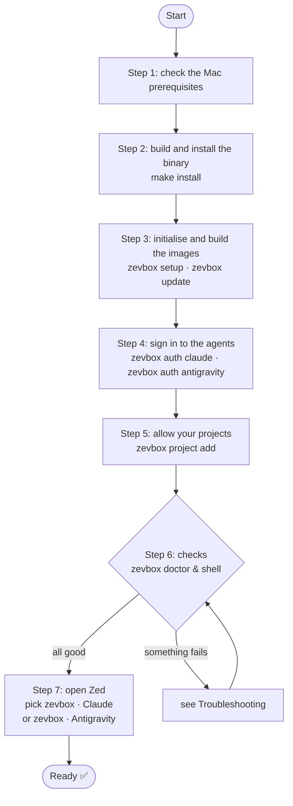
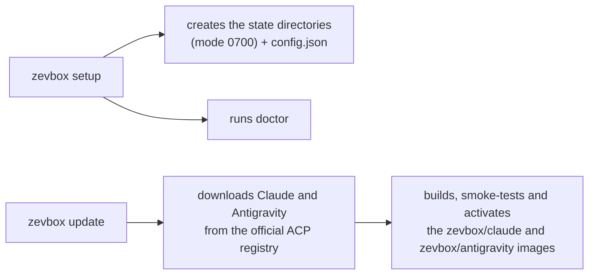
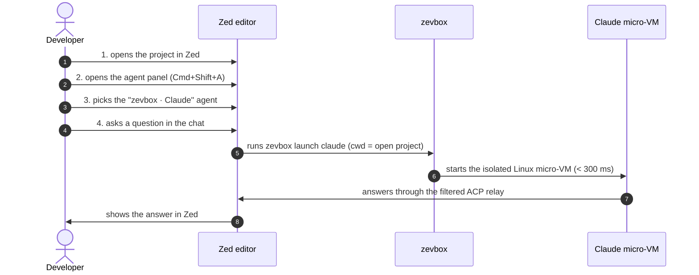

# zevbox — User Guide

**English** · [Français](fr/GUIDE_UTILISATEUR.md)

This guide walks you through installing, configuring, checking and using **zevbox** with the
**Zed** editor on macOS. At the end you will have verified, not assumed, that the agent runs in
an isolated Linux micro-VM and cannot see your Mac.

---

## 1. The journey at a glance



---

## 2. Prerequisites

1. **A Mac with Apple Silicon** (M1 or later) running macOS 13 or newer.
2. **Apple Container CLI** (`container` ≥ 1.5.0), installed and running:
   ```bash
   container system status
   ```
   *It must report `running: true`.*
3. **Rust and Cargo** (`/opt/homebrew/opt/rustup/bin` or `~/.cargo/bin`).
4. **The Zed editor.**

---

## 3. Step-by-step installation

### Step 1: check your PATH
So that `zevbox` can be run from anywhere, make sure `~/.local/bin` is on your `PATH`. Add this
to your shell configuration (`~/.zshrc`) if it is not already there:
```bash
export PATH="$HOME/.local/bin:/opt/homebrew/opt/rustup/bin:$HOME/.cargo/bin:$PATH"
```
then reload:
```bash
source ~/.zshrc
```

---

### Step 2: build and install the binary
From the root of the zevbox checkout (for example `~/code/zevbox`):

```bash
make install
```

**What it does:**
- runs formatting, lints and the full test suite (`make check`);
- builds an optimised release binary;
- installs it as `~/.local/bin/zevbox`.

**Check:**
```bash
zevbox --help
```
*You should see the list of the 16 commands.*

---

### Step 3: initialise the environment and build the agent images

> **Shortcut**: `zevbox auth <agent>` (step 4) runs `init` and then `update` for that agent when
> needed. This step is only useful to prepare everything at once or to update the images; you
> can skip it.

```bash
zevbox setup
zevbox update
```



**What they do:**
1. `setup` creates the private (`0700`) state directories and `config.json`, builds missing
   releases (like `update`), offers to authenticate each agent that is not signed in (terminal
   only; otherwise it prints the `zevbox auth <agent>` command to run), starts the Apple
   Container runtime if it is stopped, runs `doctor` and prints a per-agent summary. It is
   idempotent: run again, it rebuilds nothing.
2. `update` builds one image per agent (about 1–3 minutes each, network required) and promotes
   it as the active release. Run it again whenever `zevbox update --check` reports a new version.

> **Note**: `zevbox setup` does not register any project unless you pass a path. Step 5 does
> that. You can also do everything at once with `zevbox setup /path/to/project` (missing images
> are built by `setup`).

---

### Step 4: sign in to the agents (once; builds the image on first use)
Agents run in a micro-VM with their own state directory (`state/<agent>/`, mounted at
`/home/agent` in the VM). You sign in to each account once; tokens persist between sessions.

#### 4a. Claude

```bash
zevbox auth claude
```

**What happens:**
1. An ephemeral micro-VM starts interactively in your terminal. It mounts none of your folders:
   only an empty throwaway directory and the agent's state.
2. Claude prints `Opening browser to sign in…` followed by a
   `https://claude.com/cai/oauth/authorize?…` URL. **The browser does not open by itself** (the
   process runs inside the VM): paste the URL into your browser.
3. Sign in with your Claude account (Pro / Team / Max) and approve; paste the code shown into
   the terminal at `Paste code here if prompted >`.
4. `Login successful.` — the token is stored in `state/claude/.claude/.credentials.json`
   (`0600`).

**Default model.** Before starting the VM, `auth` writes `state/claude/.claude/settings.json`
(`{"model": "…"}`, `0600`) if it does not exist: the `model` from your own
`~/.claude/settings.json` (read only, never mounted) or `fable`. Without it Claude starts on
Haiku 4.5, which has no Auto mode. To change models, edit that file; `auth` never overwrites it.

#### 4b. Antigravity (Gemini, personal Google account)

```bash
zevbox auth antigravity
```

**What happens:**
1. zevbox starts a tiny HTTP server **on your Mac** (`127.0.0.1`, random port — no port is
   published on the micro-VM) and prints the Google sign-in URL. If the browser does not open,
   paste it. zevbox waits up to 5 minutes for Google to redirect back.
2. Choose your **Google AI Pro / One AI Premium** account and click **Allow**.
3. The browser shows a success page; the terminal prints
   `Exchanging authorization code with Google...` then
   `Google Antigravity authenticated successfully.`
4. `settings.json` and `acp_token.json` are written to
   `state/antigravity/.gemini/antigravity-acp/` (`0600`). The macOS keychain is never touched.

**Check:**
```bash
zevbox auth claude --status
zevbox auth antigravity --status
```
*Each must print exactly:*
```text
authenticated
```

---

### Step 5: allow your projects
zevbox never mounts a directory into a micro-VM unless it has been explicitly allowed (invariant
I2). For each project you want to open with an agent:

```bash
zevbox project add /absolute/path/to/project
```

**What it does:**
1. Validates the path (rejects `/`, `$HOME` and its parents, system folders, zevbox's own
   folders).
2. Adds it to the allow-list in `config.json`.
3. Makes sure both **`zevbox · Claude`** and **`zevbox · Antigravity`** entries exist in Zed
   (`~/.config/zed/settings.json`, with a backup in `backups/` if anything changes). No Zed
   restart needed.

Repeat for each project. `zevbox project list` shows the list; `zevbox project remove <path>`
removes one (the Zed entries stay: they do not depend on projects).

> **Why only two entries?** Zed's agent servers are a global setting, visible from every
> project. The `zevbox · …` entries therefore carry no path: at launch, zevbox takes the folder
> open in Zed (first root folder) and checks it against the allow-list. In a folder that is not
> allowed, Zed shows `… is not an allowed project. Fix: run 'zevbox project add …'` (see
> Troubleshooting, problem 2).

---

## 4. Checks: prove that everything works

Before opening Zed, run these three quick checks.

### Check 1: the built-in diagnosis
```bash
zevbox doctor
```

**Expected:** every line `[OK  ]`:
```text
[OK  ] config               — config.json is valid
[OK  ] container_binary     — Apple Container 1.5.0 (arm64)
[OK  ] system_status        — Apple Container runtime is running
[OK  ] architecture         — host architecture is arm64
[OK  ] project:...          — project directory exists
[OK  ] agent:claude         — release claude-... (authenticated)
[OK  ] agent:antigravity    — release antigravity-... (authenticated)
[OK  ] permissions          — stateRoot is 0700
```

---

### Check 2: live isolation test (shell inside the micro-VM)
To see for yourself that the agent is confined and cannot touch your Mac, open an interactive
shell in the VM:
```bash
zevbox shell claude
```

You should see the banner:
```text
zevbox Linux shell — agent=claude project=~/code/zevbox release=claude-... (changes outside the project are discarded on exit)
```

In that Linux shell, run:

```bash
# 1. Kernel: you are in a Linux VM, not on macOS
uname -s
# → Linux

# 2. User inside the VM
whoami
# → agent

# 3. You start at the root of your project
pwd
# → the exact path of your project

# 4. THE test: try to see your Mac's SSH keys
ls -la ~/.ssh
# → No such file or directory (your Mac is invisible)

# 5. Leave
exit
```
As soon as you type `exit`, the micro-VM is destroyed and every temporary file created outside
the project is gone.

---

### Check 3: Zed configuration
```bash
grep -C 4 "zevbox · " ~/.config/zed/settings.json
```

**Expected:** exactly two blocks, however many projects you allowed:
```json
    "zevbox · Claude": {
      "type": "custom",
      "command": "/Users/<user>/.local/bin/zevbox",
      "args": ["launch", "claude"],
      "env": {}
    },
    "zevbox · Antigravity": {
      "type": "custom",
      "command": "/Users/<user>/.local/bin/zevbox",
      "args": ["launch", "antigravity"],
      "env": {}
    }
```

---

## 5. Everyday use in Zed

Everything is set up. The diagram shows Claude; Antigravity is identical:



### In Zed:

1. **Open an allowed project** (one root folder per window):
   ```bash
   zed ~/code/demo-app
   ```
2. **Open the agent panel**: `Cmd + Shift + A` (or *View > Toggle Assistant Panel*).
3. **Pick the agent server**: at the top of the panel, in the "New Thread" / agent menu, choose
   **`zevbox · Claude`** or **`zevbox · Antigravity`**. These are the only zevbox entries; they
   apply to the open project.
4. **Try it**:
   > *"Which operating system are you running on? List the files in the current directory."*

   The agent should report **Linux arm64** and list your project files faithfully — without
   ever having access to the rest of your Mac.

---

## 6. Do / don't

| ✅ Do | ❌ Don't |
|---|---|
| **Add projects with `zevbox project add <path>`** so they are on the allow-list. | **Don't try to mount `$HOME` itself, `/` or system folders** (rejected immediately by I2). |
| **Use `zevbox tools add <package>`** to give the agent extra Linux tools (e.g. `ripgrep`, `clang`, `jq`). | **Don't `sudo apt install` inside a session** (the VM is ephemeral and capabilities are dropped). |
| **Run `zevbox stop`** at the end of the day to free background instances. | **Never run `container stop --all` by hand** (it would stop your own non-zevbox containers). |
| **Run `zevbox doctor`** when something looks odd. | **Don't hand-edit the `zevbox · …` keys in Zed's settings** (use `zevbox zed install` / `zevbox zed uninstall`). |

---

## 7. Troubleshooting

### Problem 1: Zed shows `Claude is not authenticated` (or `Antigravity is not authenticated`)
- **Cause**: the agent's token is not in its state directory yet.
- **Fix**: in a terminal, run `zevbox auth claude` (or `zevbox auth antigravity`), then check with
  `zevbox auth <agent> --status`.

### Problem 2: Zed shows `... is not an allowed project. Fix: run 'zevbox project add ...'`
- **Cause**: the folder open in Zed is not on the allow-list.
- **Fix**: add it (no Zed restart; just start a new thread):
  ```bash
  zevbox project add /path/to/that/folder
  ```

### Problem 3: Zed shows `zevbox: this agent is bound to <A>; this session asked for <B>`
- **Cause**: the Zed session asks for a folder (`<B>`) different from the one the agent was
  launched in (`<A>`) — in practice a multi-root Zed workspace.
- **Fix**: open one root folder per Zed window.

### Problem 3b: Zed shows `Auto mode unavailable: the selected model does not support Auto mode`
- **Cause**: Claude's default model in the VM is Haiku 4.5 (no Auto mode); Zed applies the mode
  before the model.
- **Fix**: `zevbox doctor` reports `no default model`; run `zevbox auth claude` or write
  `{"model": "fable"}` to `state/claude/.claude/settings.json` (see step 4a), then open a new
  thread.

### Problem 4: Zed shows `Apple Container system is not running`
- **Cause**: the Apple Container runtime is stopped.
- **Fix**:
  ```bash
  container system start
  ```

### Problem 5: you want the previous version of an agent back
- **Cause**: a recent registry update of Claude introduced an unwanted behaviour.
- **Fix**: instant rollback:
  ```bash
  zevbox rollback --agent claude
  ```

---

## 8. Essential commands

| Action | Command |
|---|---|
| Diagnose the system | `zevbox doctor` |
| Build / update the agent images | `zevbox update` |
| Sign in to Claude / Google (Antigravity) | `zevbox auth claude` / `zevbox auth antigravity` |
| Check sign-in status | `zevbox auth claude --status` / `zevbox auth antigravity --status` |
| Open a Linux test shell | `zevbox shell claude` |
| Allow a new project | `zevbox project add /my/project` |
| Add a Linux tool to the VM | `zevbox tools add ripgrep` |
| Read recent logs | `zevbox logs` |
| Stop the running VMs | `zevbox stop` |
| Clean up stale files | `zevbox clean --images` |
