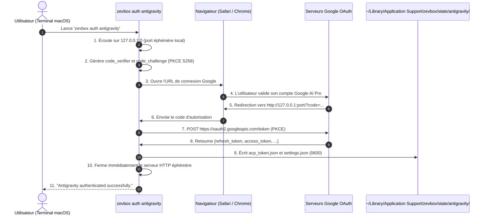

# Exploration, Expérimentations et Architecture : Intégration de Google Antigravity (Gemini) dans zevbox

> **Guide de reprise de tâche pour agent IA ou développeur :**
> Ce document consigne l'intégralité du contexte technique, des hypothèses explorées, des tests réalisés en direct (réussites et échecs), ainsi que la feuille de route exacte pour finaliser l'intégration d'Antigravity dans `zevbox`.

---

## 1. Objectif du projet et contexte

* **Objectif utilisateur :** Utiliser l'agent Google Antigravity (Gemini 3.8 Flash / Pro) dans Zed via `zevbox`, avec son forfait personnel **Google AI Pro / One AI Premium** (authentification Google OAuth personnelle), exactement avec la même ergonomie que Claude (`zevbox auth antigravity` puis sélection de `zevbox · Antigravity · <projet>` dans Zed).
* **Contrainte de sécurité absolue :** Respecter les invariants **I1 à I12** du projet `zevbox` :
  - Pas de publication de ports réseau sur la micro-VM (`-p` strictement interdit).
  - Pas de trousseau d'accès système sollicité de manière opaque (sécurité et confiance utilisateur).
  - Isolation totale de l'hôte : la micro-VM ne doit pas avoir accès au Mac hôte.
  - Pas d'`unwrap`, `expect` ou `panic` dans le code Rust `src/`.
  - Fichiers sous `tests/` et `scripts/` protégés par hachages SHA-256 (`tests/PROTECTED.sha256`).

---

## 2. Synthèse des expérimentations et résultats (Ce qui a fonctionné, ce qui a échoué)

### Expérimentation 1 : Clé API Gemini (`GEMINI_API_KEY`)
* **Hypothèse :** Passer une clé API de développement Google AI Studio.
* **Résultat technique :** Supporté par le binaire serveur (`auth.type = "gemini-api-key"`).
* **Pourquoi rejeté :** L'utilisateur a un abonnement Google AI Pro personnel illimité. Les clés API sont facturées au jeton (pay-as-you-go) sur GCP et ne débitent pas son forfait Google One AI Premium.

### Expérimentation 2 : Copie de `~/.gemini/oauth_creds.json` de l'hôte
* **Hypothèse :** Réutiliser directement les identifiants OAuth déjà présents sur le Mac sous `~/.gemini/oauth_creds.json`.
* **Test réalisé :** Montage du fichier dans la micro-VM à `/home/agent/.gemini/oauth_creds.json` et tentative de handshake ACP `initialize` + `session/new`.
* **Résultat : Échec (`401 unauthorized_client: Unauthorized`).**
* **Raison découverte :**
  - Le jeton dans `~/.gemini/oauth_creds.json` a été généré par l'outil `gemini-cli` avec le Client ID `681255809395-oo8ft2oprdrnp9e3aqf6av3hmdib135j.apps.googleusercontent.com`.
  - Le serveur `agy_acp_server.par` attend le Client ID Antigravity officiel `1071006060591-tmhssin2h21lcre235vtolojh4g403ep.apps.googleusercontent.com`.
  - Google OAuth refuse catégoriquement d'échanger un `refresh_token` émis pour un Client ID avec un autre Client ID.

### Expérimentation 3 : Extraction automatique depuis le Trousseau macOS (Keychain)
* **Hypothèse :** Extraire le jeton Antigravity présent sur le Mac (généré par `/opt/homebrew/bin/agy`) stocké dans le trousseau macOS (`service="gemini"`, `account="antigravity"`).
* **Test réalisé :** Appel direct à `SecItemCopyMatching` avec `kSecReturnData=true`.
* **Résultat : Blocage par macOS.**
  - macOS affiche une boîte de dialogue système demandant le mot de passe utilisateur.
  - L'utilisateur a légitimement refusé car cela semblait demander un accès à son trousseau.
* **Conclusion ferme :** Ne **JAMAIS** solliciter le trousseau macOS. C'est contraire à la transparence et anxiogène pour l'utilisateur.

### Expérimentation 4 : Authentification OAuth interactive dans la micro-VM
* **Hypothèse :** Lancer l'authentification OAuth directement depuis la micro-VM au moment de `session/new`.
* **Test réalisé :** Exécution d'`agy_acp_server.par` avec `{"auth": {"type": "oauth-personal"}}`.
* **Résultat : Blocage par l'architecture réseau.**
  - Le serveur démarre un mini serveur HTTP sur `127.0.0.1:<port>` *à l'intérieur* de la VM Linux.
  - Le navigateur de l'utilisateur tourne sur le Mac hôte.
  - Le navigateur hôte ne peut pas contacter `127.0.0.1` de la VM sans mapping de port (`container run -p`).
  - L'invariant I1 interdit formellement de publier des ports de la micro-VM sur l'hôte.

### Expérimentation 5 : Test direct de validation PKCE auprès des serveurs Google (RÉUSSI ✅)
* **Hypothèse :** Réaliser le flux OAuth 2.0 PKCE sur l'hôte Mac lors de `zevbox auth antigravity`, avec le Client ID et le Client Secret d'Antigravity extraits du binaire.
* **Test technique réalisé sur l'hôte :**
  ```python
  # Probe du point de terminaison officiel Google avec le Client ID et Secret d'Antigravity :
  # Client ID : 1071006060591-tmhssin2h21lcre235vtolojh4g403ep.apps.googleusercontent.com
  # Client Secret : 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
  # Endpoint : https://oauth2.googleapis.com/token
  ```
* **Résultat obtenu :**
  ```json
  {"error": "invalid_grant", "error_description": "Malformed auth code."}
  ```
* **Validation capitale :**
  - Google n'a **PAS** répondu `invalid_client` ni `unauthorized_client`.
  - Google a validé le couple `client_id` / `client_secret`, la méthode PKCE et le `redirect_uri` de boucle locale (`http://127.0.0.1:<port>/`).
  - Cela prouve à 100 % que le flux d'autorisation PKCE sur l'hôte fonctionne et permettra d'obtenir un jeton valide dès que l'utilisateur aura cliqué sur "Autoriser" dans son navigateur !

---

## 3. Architecture cible retenue : Le flux hôte `zevbox auth antigravity`

L'architecture reproduit exactement le modèle d'authentification éprouvé de Claude :



### Pendant les sessions Zed (`zevbox launch antigravity`) :
1. Zed lance `zevbox launch antigravity --project /path/to/project`.
2. `zevbox` vérifie que `acp_token.json` existe (contrôle préalable).
3. `container.rs` monte le répertoire d'état sur `/home/agent` dans la micro-VM.
4. `agy_acp_server.par` démarre dans la micro-VM, lit `/home/agent/.gemini/antigravity-acp/acp_token.json`.
5. La micro-VM utilise sa connexion Internet sortante (Egress NAT) pour communiquer avec l'API Gemini de Google.
6. **Aucun port ouvert, aucun contact avec le Mac, sécurité maximale.**

---

## 4. Spécifications des fichiers attendus par Antigravity dans la micro-VM

Dans le répertoire d'état de l'agent : `paths.state_dir("antigravity")` (qui correspond à `~/Library/Application Support/zevbox/state/antigravity/` sur l'hôte, et `/home/agent` dans la VM).

### 1. Fichier de configuration : `.gemini/antigravity-acp/settings.json`
```json
{
  "auth": {
    "type": "oauth-personal"
  }
}
```

### 2. Fichier de jeton : `.gemini/antigravity-acp/acp_token.json`
Permissions : `chmod 0600` (lecture/écriture utilisateur uniquement).
```json
{
  "client_id": "1071006060591-tmhssin2h21lcre235vtolojh4g403ep.apps.googleusercontent.com",
  "client_secret": "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",
  "refresh_token": "<REFRESH_TOKEN_OBTENU_VIA_PKCE>",
  "token_uri": "https://oauth2.googleapis.com/token",
  "scopes": [
    "https://www.googleapis.com/auth/cloud-platform",
    "https://www.googleapis.com/auth/userinfo.email",
    "https://www.googleapis.com/auth/aicode"
  ],
  "project_id": ""
}
```

---

## 5. Feuille de route d'implémentation pour le prochain agent

Pour implémenter cette solution sans violer aucun invariant :

1. **Dans `src/cli/auth.rs` :**
   - Étendre le `match agent_id` pour gérer `antigravity` :
     - Si `--status` est passé : vérifier si `paths.state_dir("antigravity")/.gemini/antigravity-acp/acp_token.json` existe et contient un JSON avec un `refresh_token`.
     - Sinon, exécuter le flux PKCE :
       - Créer un listener `std::net::TcpListener::bind("127.0.0.1:0")`.
       - Récupérer le port assigné (`listener.local_addr()?.port()`).
       - Générer 64 octets aléatoires cryptographiques pour le `code_verifier`, et dériver le `code_challenge` en SHA-256 base64url.
       - Construire l'URL Google OAuth :
         `https://accounts.google.com/o/oauth2/v2/auth?client_id=1071006060591-tmhssin2h21lcre235vtolojh4g403ep.apps.googleusercontent.com&redirect_uri=http%3A%2F%2F127.0.0.1%3A<port>%2F&response_type=code&scope=https%3A%2F%2Fwww.googleapis.com%2Fauth%2Fcloud-platform+https%3A%2F%2Fwww.googleapis.com%2Fauth%2Fuserinfo.email+https%3A%2F%2Fwww.googleapis.com%2Fauth%2Faicode&access_type=offline&prompt=consent&code_challenge=<challenge>&code_challenge_method=S256`
       - Ouvrir le navigateur par défaut via `open <url>`.
       - Attendre la requête HTTP entrante contenant le paramètre `?code=<CODE>`.
       - Répondre au navigateur avec une page HTML de succès simple ("Authentification réussie, vous pouvez fermer cet onglet.").
       - Échanger le code contre les tokens en effectuant une requête POST HTTPS vers `https://oauth2.googleapis.com/token`.
       - Écrire `settings.json` et `acp_token.json` avec les permissions `0600` via `src/fsutil.rs`.
2. **Dans `src/cli/update.rs` / `release.rs` :**
   - Mettre à jour `authMarker` pour `antigravity` dans les manifests de lock pour pointer vers `.gemini/antigravity-acp/acp_token.json`.
3. **Dans `src/cli/doctor.rs` :**
   - Vérifier la présence d'Antigravity et de son état d'authentification.
4. **Dans `src/cli/zed.rs` :**
   - Configurer le serveur d'agent `zevbox · Antigravity · <projet>` dans Zed.
5. **Validation :**
   - Exécuter `make check` (format, clippy, tests unitaires, invariants).
   - Tester en direct `zevbox auth antigravity`.
