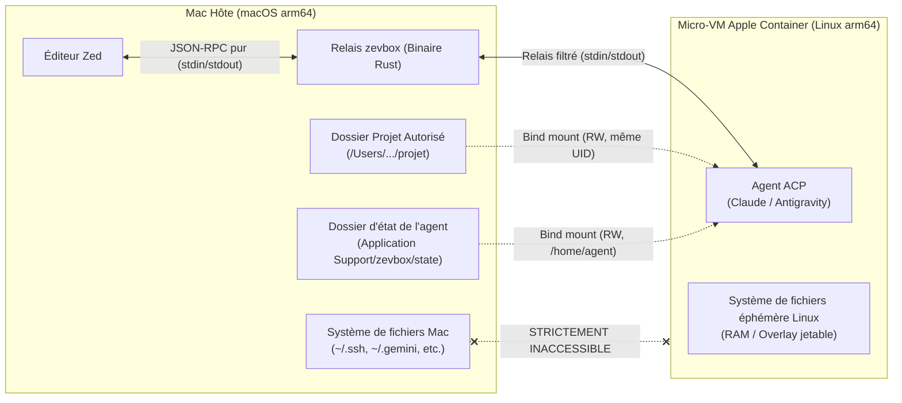
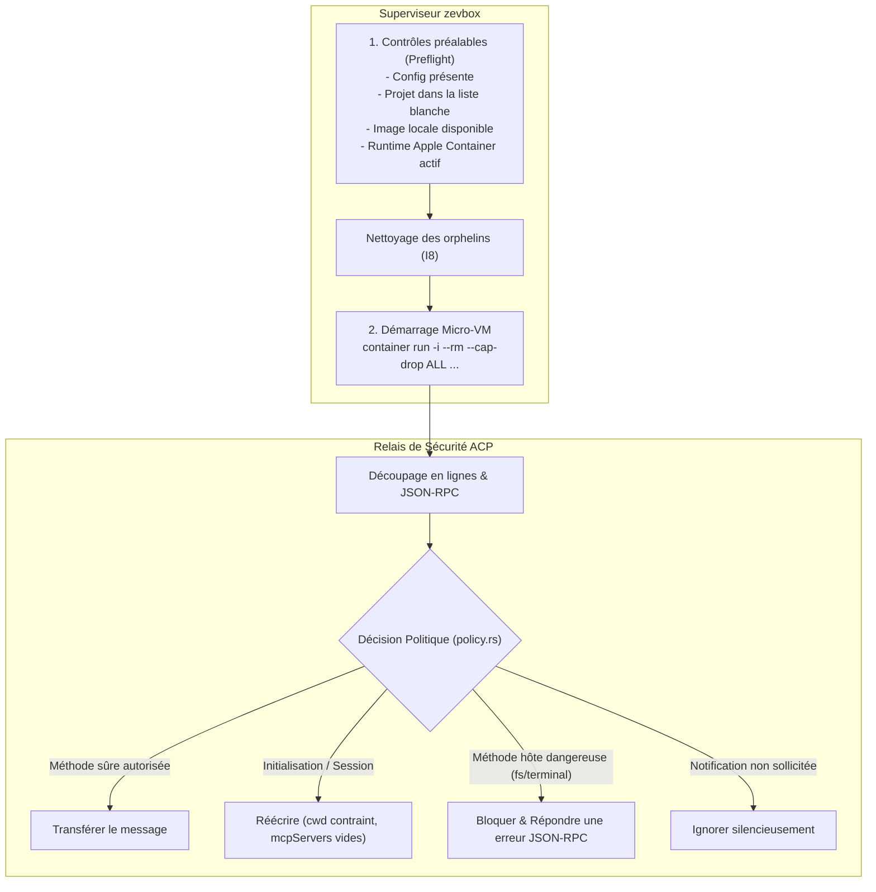
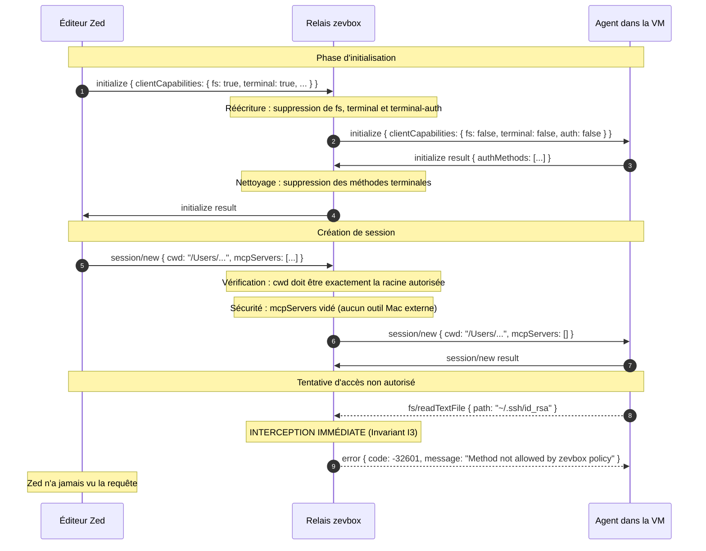
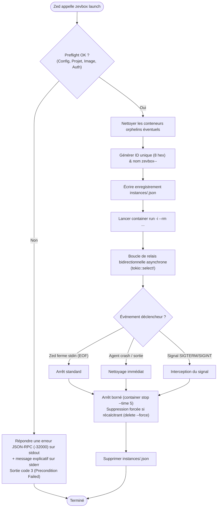
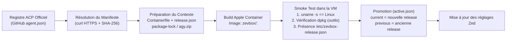

# zevbox — Architecture, Fonctionnement et Sécurité

[English](../ARCHITECTURE.md) · **Français**

Ce document présente une vue d'ensemble détaillée du projet **`zevbox`**, de ses choix d'architecture, de son modèle de sécurité, ainsi que du fonctionnement interne du relais ACP et des micro-VM Apple Container.

---

## 1. Contexte et Problématique

### Le problème avec les agents IA dans l'éditeur (Zed)
Lorsqu'un éditeur comme **Zed** intègre un agent IA via le protocole ACP (*Agent Client Protocol*, p. ex. Claude Code ou Google Antigravity), cet agent s'exécute habituellement directement sur votre Mac avec l'ensemble de vos privilèges utilisateurs.

Cela signifie qu'un agent pourrait :
- Lire vos clés privées SSH (`~/.ssh/id_rsa`), identifiants cloud (`~/.aws`, `~/.config/gcloud`), trousseaux et variables d'environnement.
- Exécuter des commandes arbitraires sur votre machine hôte (`rm -rf`, installations incontrôlées, accès réseau non sollicité).
- Modifier des fichiers personnels sans rapport avec le projet en cours de développement.

### La solution : `zevbox`
`zevbox` isole complètement l'agent dans une **micro-VM Apple Container Linux arm64** éphémère. Il interpose entre Zed et la VM un **relais filtrant intelligent** qui inspecte et neutralise tout appel potentiellement dangereux.

---

## 2. Pourquoi des Micro-VM Apple Container ? (L'intérêt Technologique)

Le choix des **micro-VM Apple Container** est au cœur de la stratégie de confinement de `zevbox`. Il est crucial de comprendre la différence fondamentale entre les conteneurs traditionnels, les machines virtuelles classiques et les micro-VMs natives d'Apple.

### 2.1 Comparatif des technologies d'isolation

```mermaid
flowchart TD
    subgraph HostExec ["1. Exécution Directe sur l'Hôte"]
        H1["Agent IA"] --> H2["Noyau macOS (XNU)"]
        H2 --> H3["Accès direct à TOUS vos fichiers personnels (~/.ssh, etc.)"]
    end

    subgraph ClassicDocker ["2. Conteneurs Linux Classiques (Docker sous Linux)"]
        D1["Agent en Conteneur"] --> D2["Noyau Linux Partagé (Namespaces / cgroups)"]
        D2 -.->|"Évasion de conteneur possible si faille noyau (CVE)"| D3["Hôte Compromis"]
    end

    subgraph AppleVM ["3. Micro-VM Apple Container (Architecture zevbox)"]
        A1["Agent en Micro-VM"] --> A2["Noyau Linux Dédié Guest en RAM"]
        A2 --> A3["Barrière Matérielle Hyperviseur (Apple Virtualization.framework / ARM EL2)"]
        A3 --> A4["Noyau macOS Protégé (Aucun accès aux fichiers hors des 2 montages)"]
    end
```

### 2.2 Les 5 atouts décisifs d'Apple Container

#### 1. Barrière matérielle (Hardware-enforced Hypervisor boundary)
- **Conteneur classique (Linux)** : L'isolation repose sur des fonctionnalités logicielles du système d'exploitation (`namespaces`, `cgroups`, `chroot`). L'agent et l'hôte partagent le *même* noyau. Si une vulnérabilité noyau est exploitée, l'attaquant s'échappe directement sur l'hôte.
- **Apple Container (macOS)** : Chaque conteneur est en réalité une **vraie micro-machine virtuelle** distincte pilotée par le framework natif `Virtualization.framework` d'Apple. La séparation est garantie au niveau du silicium par les extensions de virtualisation matérielle Apple Silicon (ARM EL2). Même un attaquant qui obtiendrait les droits `root` absolus et corromprait le noyau Linux de la micro-VM se heurte à la barrière physique de l'hyperviseur macOS.

#### 2. Démarrage instantané (Sub-seconde vs VM lourdes)
- Une machine virtuelle traditionnelle (UTM, Parallels, VirtualBox) émule une carte mère complète, charge un BIOS/UEFI, boote un OS lourd et met 15 à 30 secondes à démarrer tout en consommant plusieurs gigaoctets de RAM fixe.
- Les micro-VM Apple Container démarrent en **moins de 300 millisecondes**. Elles démarrent directement un noyau Linux minimal en mémoire sans émulation matérielle superflue. Du point de vue de l'utilisateur dans Zed, le lancement de l'agent paraît instantané.

#### 3. Partage de fichiers natif haute performance via `virtiofs`
- Docker Desktop sur Mac souffre historiquement d'une latence d'I/O très lourde lors de l'accès aux fichiers du Mac (passerelles osxfs/gRPC FUSE ralenties).
- Apple Container utilise **`virtiofs`**, directement intégré au noyau macOS et au noyau Linux invité via un canal mémoire partagé. L'agent lit et modifie les fichiers de votre projet à la vitesse native du SSD NVMe de votre Mac.

#### 4. Préservation stricte des permissions (`host_uid` / `host_gid`)
- Dans un environnement Docker classique, les fichiers écrits par un conteneur appartiennent souvent à `root`, bloquant l'utilisateur sur son Mac pour modifier ou commiter ses propres fichiers.
- `zevbox` mappe exactement votre UID/GID macOS (`id -u` / `id -g`, p. ex. 501:20) dans la VM. Les fichiers créés ou modifiés par Claude ou tout autre agent appartiennent immédiatement à votre utilisateur macOS sans root-squash ni conflit de permissions.

#### 5. Éphémérité totale (`--rm`) et délestage des capacités (`--cap-drop ALL`)
- La micro-VM est créée avec une couche overlay temporaire en mémoire RAM. Dès que Zed ferme la session, la VM est anéantie : tous les fichiers temporaires, scripts de compilation ou artefacts générés hors du projet s'évaporent sans polluer votre Mac.
- De surcroît, le conteneur démarre avec l'option `--cap-drop ALL` : même le compte `root` interne à la VM ne dispose d'aucun privilège système Linux spécial (`CAP_SYS_ADMIN`, `CAP_NET_ADMIN`, etc.).

---

## 3. Architecture Globale du Projet

L'architecture repose sur quatre composants clés :

1. **Le Superviseur & CLI (`src/supervisor.rs`, `src/cli/`)** :
   - Gère le cycle de vie de la micro-VM et du binaire Apple Container (`container`).
   - Effectue les vérifications préalables (*preflight*) avant tout lancement.
   - Assure un arrêt propre et borné (*bounded shutdown*) en cas de sortie de Zed.
2. **Le Relais ACP (`src/relay/mod.rs`, `src/relay/policy.rs`)** :
   - Analyse chaque trame JSON-RPC transitant entre Zed et l'agent.
   - Applique une politique de sécurité stricte (*zero trust*) définie par des fonctions pures et auditées.
3. **Le Moteur de Conteneurs (`src/container.rs`)** :
   - Construit les arguments précis d'invocation du CLI `container`.
   - Applique le délestage complet des capacités Linux (`--cap-drop ALL`), l'interdiction de TTY pour le protocole ACP, et la correspondance exacte UID/GID de l'hôte.
4. **Le Gestionnaire de Releases (`src/release.rs`)** :
   - Télécharge et vérifie les manifestes officiels des registres ACP.
   - Construit les images Linux basées sur une image Debian (`node:22-bookworm-slim`) figée par empreinte cryptographique SHA-256.
   - Exécute des tests de fumée (*smoke tests*) avant toute promotion.

---

## 4. Le Cœur de Sécurité : La Politique du Relais

Le protocole ACP permet théoriquement à l'agent de demander à l'éditeur d'exécuter des actions sur la machine (par exemple `fs/readTextFile`, `terminal/create`).

Dans `zevbox`, la politique de sécurité neutralise totalement cette surface d'attaque :

### Ce que le relais fait sur chaque message

### Table des verdicts de sécurité

| Direction | Méthode ACP | Action de zevbox | Raison de sécurité |
|---|---|---|---|
| **Client → Agent** | `initialize` | **Réécrit** | Désactive toutes les capacités hôtes (`fs=false`, `terminal=false`). |
| **Client → Agent** | `session/new` | **Réécrit** | Force le `cwd` sur la racine du projet, vide `mcpServers`. |
| **Agent → Client** | `fs/readTextFile`, `fs/writeTextFile` | **Bloqué** (erreur -32601) | Interdit à l'agent de lire/écrire sur le Mac via Zed. |
| **Agent → Client** | `terminal/create`, `terminal/exec` | **Bloqué** (erreur -32601) | Interdit à l'agent d'ouvrir un terminal sur le Mac. |
| **Agent → Client** | `authenticate` (terminal) | **Bloqué** | Empêche d'exécuter du code d'authentification sur l'hôte. |
| **Agent → Client** | `session/update`, `notifications` | **Transféré** | Permet à l'agent de renvoyer ses réponses et son streaming à Zed. |

---

## 5. Cycle de Vie d'une Session

Le superviseur garantit qu'aucun conteneur orphelin ne reste actif, même si Zed plante ou est forcé à quitter.

---

## 6. Gestion des Versions : Releases, Build et Rollback

`zevbox` utilise un pipeline de release immuable : chaque version d'un agent génère un identifiant horodaté unique (`<agent>-AAAAMMJJ-HHMMSS`) et un fichier de verrouillage (`lock.json`).

Si une régression apparaît, la commande `zevbox rollback --agent <agent>` intervertit immédiatement `current` et `previous` dans `active.json` en moins d'une seconde, sans nécessiter de recompilation.

---

## 7. Analyse Détaillée : Claude vs Antigravity

Pourquoi Claude se connecte-t-il depuis l'intérieur de la VM alors qu'Antigravity nécessite une étape côté Mac ?

```mermaid
flowchart TD
    subgraph ClaudeAuth ["Claude Code (dans la VM)"]
        C1["Commande : zevbox auth claude"] --> C2["Lancement conteneur interactif : container run -it ..."]
        C2 --> C3["Exécution : claude-agent-acp --cli auth login"]
        C3 --> C4["L'utilisateur se connecte dans le terminal"]
        C4 --> C5["Jeton sauvegardé dans : state/claude/.claude/.credentials.json"]
        C5 --> C6["Marqueur détecté : AUTHENTIFIÉ ✅"]
    end

    subgraph AgyAuth ["Flux natif d'Antigravity (ne fonctionne pas depuis une VM)"]
        A1["Méthode ACP : authenticate(oauth-personal)"] --> A2["agy_acp_server.par démarre un serveur web HTTP interne\nsur http://127.0.0.1:<port-aléatoire>/ dans la VM"]
        A2 --> A3["Lien ouvert dans le navigateur du Mac hôte"]
        A3 --> A4["Google redirige le navigateur vers http://127.0.0.1:<port-aléatoire>/"]
        A4 --> A5{"Où écoute le port ?"}
        A5 -- "Navigateur cherche sur le Mac" --> A6["Connexion Refusée (Connection Refused) ❌\n(Le port n'écoute que dans la VM)"]
        A5 -. "Publication de port (--publish) ?" .-> A7["INTERDIT par la politique de sécurité (I1, §8.2)"]
    end
```

zevbox exécute donc le flux OAuth 2.0 **PKCE d'Antigravity sur l'hôte** (`zevbox auth antigravity`) : un serveur HTTP éphémère sur `127.0.0.1:<port aléatoire>` reçoit la redirection de Google, le code est échangé contre des jetons, et le résultat est écrit dans `state/antigravity/.gemini/antigravity-acp/{settings.json,acp_token.json}` (`0600`) — le dossier que l'agent voit comme `/home/agent/.gemini/antigravity-acp/` dans la VM. Aucun port n'est publié sur la VM et le trousseau macOS n'est jamais sollicité.

### Synthèse comparative

| Critère | Claude Code | Google Antigravity |
|---|---|---|
| **Nature du composant ACP** | Paquet npm (`@agentclientprotocol/claude-agent-acp`) | Archive exécutable Python Hermétique (`agy_acp_server.par`) |
| **Mode d'authentification** | CLI console interactif (`--cli auth login`) dans la VM | OAuth 2.0 PKCE exécuté par zevbox sur le Mac |
| **Fonctionne depuis une VM isolée** | **oui** (pas de serveur local nécessaire) | **non** — d'où le flux côté hôte |
| **Emplacement du jeton (dans la VM)** | `/home/agent/.claude/.credentials.json` | `/home/agent/.gemini/antigravity-acp/acp_token.json` |

---

## 8. Les 12 Invariants de Sécurité

Ces règles sont testées automatiquement à chaque compilation (`scripts/check-invariants.sh`) et ne peuvent jamais être relâchées :

1. **I1 — Deux montages exclusifs** : Seuls le dossier du projet et le dossier d'état de l'agent sont montés. Les dossiers personnels (`$HOME`, `~/.ssh`, `~/.gemini`, etc.) ne sont jamais montés directement.
2. **I2 — Projets validés canoniquement** : Seuls les répertoires explicitement listés dans `config.projects` sont accessibles.
3. **I3 — Blocage du système de fichiers et du terminal hôte** : Aucun appel `fs/*` ou `terminal/*` ne parvient à Zed.
4. **I4 — Filtrage bidirectionnel par ID** : Seules les méthodes répertoriées sont routées, les réponses sont associées à leur requête en attente.
5. **I5 — Confinement du répertoire de travail** : Le `cwd` est invariablement contraint à la racine du projet autorisé.
6. **I6 — Pureté JSON-RPC sur stdout** : Seuls des messages JSON-RPC stricts sont émis sur stdout pour préserver la stabilité de Zed.
7. **I7 — Zéro shell sur l'hôte** : Aucun appel à `/bin/sh`, `bash` ou `zsh` n'est exécuté sur le Mac hôte.
8. **I8 — Ciblage chirurgical des conteneurs** : `stop` et `delete` ne ciblent que des conteneurs validés avec le préfixe `zevbox-`. L'option globale `--all` est bannie.
9. **I9 — Confidentialité des journaux** : Aucun jeton, mot de passe ou contenu de message n'est consigné dans les logs.
10. **I10 — Absence de build ou réseau au lancement** : La commande `launch` est instantanée et ne réalise aucun téléchargement.
11. **I11 — Robustesse Rust** : Zéro `unwrap()`, `expect()` ou `panic!()` dans le code de production (`src/`).
12. **I12 — Isolation de zevbox** : Les binaires et fichiers internes de zevbox ne sont jamais montés dans les conteneurs.
