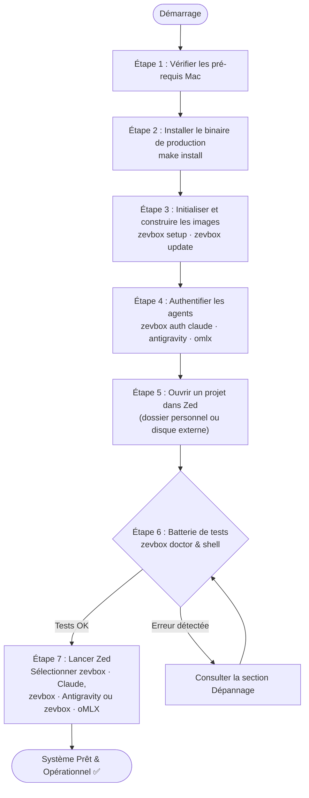
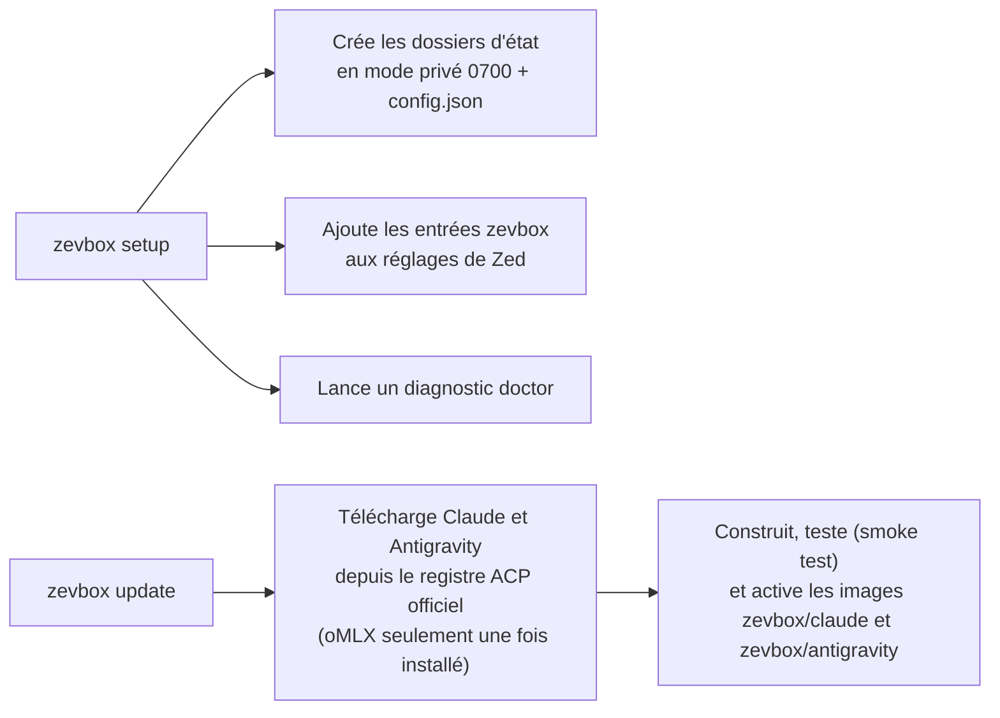
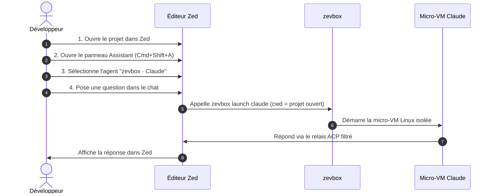

# zevbox — Guide utilisateur

[English](../USER_GUIDE.md) · **Français**

Ce manuel vous guide pas à pas pour installer, configurer, vérifier et utiliser **`zevbox`** avec l'éditeur **Zed** sur macOS.

À la fin de ce guide, vous aurez la certitude absolue que votre environnement est 100 % opérationnel, sécurisé et prêt à l'emploi.

---

## 1. Parcours Utilisateur Global

Voici les étapes que vous allez suivre :



---

## 2. Pré-requis Système

Avant de commencer, vérifiez que vous disposez des éléments suivants :

1. **Mac avec puce Apple Silicon** (M1, M2, M3, M4) sous une version de macOS prise en charge par Apple Container.
2. **Apple Container CLI** (`container` version ≥ 1.5.0) installé et actif :
   ```bash
   container system status
   ```
   *Le statut doit afficher `running: true`.*
3. **Rust & Cargo** installés sur votre Mac (dans `/opt/homebrew/opt/rustup/bin` ou `~/.cargo/bin`).
4. **L'éditeur Zed** installé sur votre Mac.

---

## 3. Installation et Configuration Pas-à-Pas

### Étape 1 : Vérifier votre PATH macOS
Pour pouvoir lancer `zevbox` de n'importe où dans votre terminal, assurez-vous que `~/.local/bin` fait partie de votre `PATH`.

Ajoutez cette ligne dans votre fichier de configuration shell (`~/.zshrc`) si ce n'est pas déjà fait :
```bash
export PATH="$HOME/.local/bin:/opt/homebrew/opt/rustup/bin:$HOME/.cargo/bin:$PATH"
```
Rechargez ensuite votre terminal :
```bash
source ~/.zshrc
```

---

### Étape 2 : Compiler et Installer le Binaire
Depuis le répertoire racine de `zevbox` (`~/code/zevbox`) :

```bash
make install
```

**Ce que fait cette commande :**
- Exécute les contrôles de formatage, les linters de sécurité et la suite complète de tests (`make check`).
- Compile une version release optimisée en Rust.
- Installe le binaire final dans `~/.local/bin/zevbox`.

**Vérification immédiate :**
```bash
zevbox --help
```
*Vous devez voir s'afficher la liste des 15 commandes du projet (plus `help`), dont `console`.*

---

### Étape 3 : Initialiser l'Environnement et Construire les Images des Agents

> **Raccourci** : `zevbox auth <agent>` (étape 4) fait `init` puis `update` pour cet agent si nécessaire. Cette étape n'est utile que pour tout préparer d'un coup ou pour mettre à jour les images ; vous pouvez la sauter.

```bash
zevbox setup
zevbox update
```



**Ce que font ces commandes :**
1. `setup` crée les répertoires d'état sécurisés (`0700`) et `config.json`, construit les releases manquantes (comme `update`), propose l'authentification de chaque agent non connecté (uniquement dans un terminal ; sinon elle affiche la commande `zevbox auth <agent>`), démarre le runtime Apple Container s'il est arrêté, exécute `doctor` et affiche un résumé par agent. Idempotente : relancée, elle ne reconstruit rien.
2. `update` construit une image par agent (≈ 1 à 3 minutes chacune, réseau requis) et la promeut en release active. oMLX est optionnel : `update` et `setup` ne s'en occupent qu'une fois installé par `zevbox auth omlx` (`zevbox update --agent omlx` le construit à la main). À relancer quand `zevbox update --check` signale une nouvelle version.

> **Remarque** : `zevbox setup` ne prend aucun argument et n'enregistre rien : les projets n'ont pas besoin d'être déclarés (étape 5). Il construit les images manquantes, propose la connexion et configure Zed.

---

### Étape 4 : Authentifier les Agents (une seule fois ; construit l'image au premier passage)
Les agents s'exécutent dans une micro-VM avec leur propre dossier d'état (`state/<agent>/`, monté sur `/home/agent` dans la VM). Vous connectez chaque compte une seule fois ; les jetons persistent d'une session à l'autre.

#### 4a. Claude

```bash
zevbox auth claude
```

**Déroulement :**
1. Une micro-VM éphémère démarre en mode interactif dans votre terminal. Elle ne monte aucun de vos dossiers : un dossier vide jetable et l'état de l'agent seulement.
2. Claude affiche `Opening browser to sign in…` puis une URL `https://claude.com/cai/oauth/authorize?…`. **Le navigateur ne s'ouvre pas tout seul** (le processus tourne dans la VM) : copiez l'URL dans votre navigateur.
3. Connectez-vous avec votre compte Claude (Pro / Team / Max) et autorisez l'accès ; collez le code affiché dans le terminal à l'invite `Paste code here if prompted >`.
4. `Login successful.` : le jeton est enregistré dans `state/claude/.claude/.credentials.json` (`0600`).

**Modèle par défaut.** Avant de lancer la VM, `auth` écrit `state/claude/.claude/settings.json` (`{"model": "…"}`, `0600`) s'il n'existe pas : le `model` de votre `~/.claude/settings.json` (lu seul, jamais monté) ou `fable`. Sans cela, Claude démarre sur Haiku 4.5, qui n'a pas le mode Auto. Pour changer de modèle, éditez ce fichier ; `auth` ne le réécrit jamais s'il existe.

#### 4b. Antigravity (Gemini, compte Google personnel)

```bash
zevbox auth antigravity
```

**Déroulement :**
1. zevbox ouvre un petit serveur HTTP **sur votre Mac** (`127.0.0.1`, port aléatoire — aucun port n'est publié sur la micro-VM) et affiche l'URL de connexion Google. Si le navigateur ne s'ouvre pas, copiez-la. Zevbox attend le retour de Google pendant 5 minutes.
2. Choisissez votre compte **Google AI Pro / One AI Premium** et cliquez sur **Autoriser**.
3. Le navigateur affiche « Authentification Google réussie ! » ; le terminal affiche `Exchanging authorization code with Google...` puis `Google Antigravity authenticated successfully.`
4. Les fichiers `settings.json` et `acp_token.json` sont écrits dans `state/antigravity/.gemini/antigravity-acp/` (`0600`). Le trousseau macOS n'est jamais sollicité.

#### 4c. oMLX (optionnel : un serveur de modèles local sur votre réseau)

Si un serveur [oMLX](https://github.com/jundot/omlx) tourne sur un autre Mac (par exemple un Mac
Studio), zevbox peut le piloter avec l'adaptateur Claude Code, dans sa propre VM et son propre
dossier d'état (votre abonnement Claude n'intervient pas) :

```bash
zevbox auth omlx --url http://192.168.1.8:8000
```

**Déroulement :**
1. La première fois, zevbox construit l'image `zevbox/omlx` (même adaptateur que Claude, 1-3 min).
2. Il demande la clé API du serveur (saisie masquée ; `echo "$CLE" | zevbox auth omlx --url …`
   marche aussi) et liste les modèles du serveur **depuis le Mac**.
3. Il écrit `state/omlx/.claude/settings.json` (`0600`) : l'URL et la clé, la liste des modèles
   (le sélecteur de modèles de Zed les affiche), le modèle par défaut (`--model <id>`, sinon le
   plus petit) et un hook qui décharge le modèle précédent sur le serveur quand vous changez de
   modèle dans Zed. Le plus petit modèle n'est jamais déchargé : Claude Code s'en sert pour ses
   petites requêtes de fond. Il liste aussi les modèles dans `modelPicker` : un changement dans
   Zed est immédiat (le premier prompt attend ensuite que le serveur charge le modèle) et le mode
   Auto reste disponible. Le mode de permissions par défaut est **Bypass permissions**
   (`permissions.defaultMode`) : l'agent ne demande jamais rien, il n'agit que dans sa VM et
   votre projet. Auto ferait examiner chaque outil par le modèle, lent avec des modèles locaux.
   Un mode que vous écrivez vous-même dans le fichier est conservé.
4. Il vérifie qu'**une VM** joint le serveur : `omlx: the agent VM reaches the server (HTTP 401)`.
   Les VM ne sortent que par le réseau principal du Mac (l'interface de la route par défaut) :
   une adresse jointe par un câble direct vers le serveur ne marche pas depuis une VM ; donnez
   l'adresse du serveur sur le réseau principal.

Relancez-la pour changer l'URL, la clé ou le modèle par défaut ; `Entrée` garde la clé actuelle.

**Vérification immédiate :**
```bash
zevbox auth claude --status
zevbox auth antigravity --status
zevbox auth omlx --status      # si vous utilisez oMLX
```
*Chaque commande doit renvoyer exactement :*
```text
authenticated
```

---

### Étape 5 : Savoir Où Peuvent Être Vos Projets
Il n'y a rien à enregistrer : quand vous choisissez **`zevbox · Claude`**, **`zevbox · Antigravity`** ou **`zevbox · oMLX`** avec **+** dans une fenêtre Zed, ce choix vaut consentement, et zevbox utilise le dossier ouvert dans cette fenêtre (premier dossier racine). Il vérifie seulement que ce dossier est dans une zone autorisée (invariant I2) :

- **autorisé** : tout dossier de votre dossier personnel, p. ex. `~/code/mon-app`, ou d'un disque externe, p. ex. `/Volumes/Data/travail/app` ;
- **refusé** : `~/Library`, les dossiers cachés comme `~/.ssh` ou `~/.config`, votre dossier personnel lui-même, `/`, les dossiers système, `/Applications`, `/opt/homebrew` et les dossiers de zevbox. Le Mac exécute tout seul certains fichiers de ces dossiers : un agent qui y écrirait pourrait agir sur votre Mac.

Dans un dossier refusé, Zed affiche `… is not an allowed project: <raison>` (voir Dépannage, problème 2).

> **Pourquoi une seule entrée par agent ?** Les serveurs d'agents de Zed sont un réglage global, visible depuis tous les projets. Les entrées `zevbox · …` n'embarquent donc aucun chemin : au lancement, zevbox prend le dossier ouvert dans Zed.

> **Git et l'agent.** Dans la VM, le `.git` du projet est en lecture seule et son dossier `.zed` est masqué (I13) : l'agent lit l'historique et modifie vos fichiers, qui apparaissent aussitôt dans votre dossier, mais il ne committe pas. Committez son travail vous-même, ou avec un outil hors zevbox.

---

## 4. Batterie de Tests : Confirmer que Tout Est 100 % Opérationnel

Avant même d'ouvrir Zed, exécutez ces 3 tests simples pour vous assurer que tout fonctionne parfaitement :

### Test 1 : Le Diagnostic Automatique Global
Lancez la commande de contrôle :
```bash
zevbox doctor
```

**Résultat attendu :**
Tous les voyants doivent être à `[OK  ]`. Une ligne `[WARN]` dit quoi faire, le plus souvent avec la commande qui la corrige (par exemple `zevbox auth claude`, `zevbox zed install`, `zevbox clean --images`) ; un `[FAIL]` signifie que le lancement d'un agent échouerait (par exemple son image est absente : `zevbox update --agent <agent>`) :
```text
[OK  ] config               — config.json is valid
[OK  ] container_binary     — Apple Container 1.5.0 (arm64)
[OK  ] system_status        — Apple Container runtime is running
[OK  ] architecture         — host architecture is arm64
[OK  ] agent:claude         — release claude-... (authenticated)
[OK  ] agent:antigravity    — release antigravity-... (authenticated)
[OK  ] agent:omlx           — optional, not installed (to use it: 'zevbox auth omlx')
[OK  ] disk                 — 4 zevbox image(s), none from old releases; all container images use … GB
[OK  ] permissions          — stateRoot and state/* are 0700
[OK  ] installed_binary     — /Users/<user>/.local/bin/zevbox exists
[OK  ] zed_entries          — Zed entries match the agents with an active release
[OK  ] instances            — … active instance(s), no orphan
[OK  ] blocked_methods      — no ACP method refused in the last 7 days
```
Avec oMLX installé et connecté, une ligne `omlx:server` (le serveur tel que le voit une VM d'agent) suit la ligne `agent:omlx`. `blocked_methods` liste les méthodes ACP que le relais a refusées d'après les journaux d'instance des 7 derniers jours (voir `zevbox logs`).
> Si tous les indicateurs sont à `[OK  ]`, votre installation est saine.

---

### Test 2 : Test d'Isolation en Direct (Shell dans la Micro-VM)
Pour prouver matériellement que l'agent est bien cloisonné et qu'il ne peut pas toucher à votre Mac :

Lancez un shell interactif dans la VM :
```bash
zevbox shell claude
```

Vous devez voir s'afficher la bannière de sécurité :
```text
zevbox Linux shell — agent=claude project=~/code/zevbox release=claude-... (changes outside the project are discarded on exit)
(.zed is masked and .git is read-only in this shell, as for the agent)
```

Dans ce shell Linux, tapez successivement les 4 commandes de test suivantes :

```bash
# 1. Vérifier le noyau : vous êtes bien dans une VM Linux, pas sous macOS !
uname -s
# Doit renvoyer : Linux

# 2. Vérifier l'utilisateur interne
whoami
# Doit renvoyer : agent

# 3. Vérifier que vous êtes bien positionné à la racine de votre projet
pwd
# Doit renvoyer le chemin exact de votre projet

# 4. LE TEST ULTIME DE SÉCURITÉ : Tenter de voir vos clés SSH du Mac
ls -la ~/.ssh
# Doit renvoyer : No such file or directory (votre Mac est 100 % invisible)

# 5. Quitter le shell
exit
```
Dès que vous tapez `exit`, la micro-VM est anéantie et tous les fichiers temporaires créés hors du projet sont effacés.

---

### Test 3 : Vérifier la Configuration de Zed
Vérifiez que Zed a bien reçu les entrées de vos projets :

```bash
grep -C 4 "zevbox · " ~/.config/zed/settings.json
```

**Résultat attendu :**
Un bloc par agent installé (deux, ou trois avec oMLX), quel que soit le nombre de projets :
```json
    "zevbox · Claude": {
      "type": "custom",
      "command": "/Users/<user>/.local/bin/zevbox",
      "args": ["launch", "claude"],
      "env": {}
    },
    "zevbox · Antigravity": {
      "type": "custom",
      "command": "/Users/<user>/.local/bin/zevbox",
      "args": ["launch", "antigravity"],
      "env": {}
    }
```

---

## 5. Utilisation Quotidienne dans Zed

Tout est configuré ! Vous pouvez maintenant utiliser Claude ou Antigravity dans Zed en toute sérénité (le schéma montre Claude ; Antigravity et oMLX sont identiques) :



### La Marche à Suivre dans Zed :

1. **Ouvrez un projet dans Zed** (un seul dossier racine par fenêtre, dans votre dossier personnel ou sur un disque externe) :
   ```bash
   zed ~/code/demo-app
   ```
2. **Ouvrez le panneau Assistant / Agent** :
   - Raccourci clavier : `Cmd + Shift + A` (ou menu *View > Toggle Assistant Panel*).
3. **Sélectionnez le serveur d'agent** :
   - En haut du panneau, menu « New Thread » / choix de l'agent.
   - Choisissez **`zevbox · Claude`**, **`zevbox · Antigravity`** ou **`zevbox · oMLX`** (si vous l'avez installé) : ce sont les seules entrées zevbox, elles s'appliquent au projet ouvert.
4. **Faites un test dans le chat de Zed** :
   - Tapez ce prompt de validation :
     > *"Peux-tu me dire quel est ton système d'exploitation et lister les fichiers du dossier courant ?"*
   - L'agent doit confirmer qu'il tourne sous **Linux arm64**, et lister fidèlement les fichiers de votre projet sans jamais avoir accès au reste de votre Mac.

---

### Ce qu'il y a dans la VM de l'agent, et quand c'est mis à jour

- **Le système** : la version courante d'Ubuntu (pas une LTS), choisie pour avoir Python, Node
  et des compilateurs récents.
- **Outils déjà installés**, parce que les agents s'en servent sans arrêt : Node et npm,
  Python 3 (`pip`, `venv`, `python`), `build-essential` (gcc, make), `git`, `ripgrep`, `curl`,
  `jq`, `unzip`. Ce que l'agent installe lui-même pendant une session disparaît à la suivante :
  pour garder un outil, utilisez `zevbox tools add <paquet>`. Pour les paquets Python, l'agent
  crée un environnement `python -m venv` (Ubuntu refuse `pip install` sur le Python du système).
- **Quand c'est mis à jour** : seulement quand vous lancez `zevbox update` (ou `zevbox tools
  add/remove`). zevbox prend alors la dernière Ubuntu et la dernière version de chaque agent,
  teste la nouvelle image et garde la précédente pour `zevbox rollback`. Ouvrir un thread dans
  Zed ne met jamais rien à jour : il démarre l'image déjà construite. Lancez de temps en temps
  `zevbox update --check` pour savoir si une nouvelle version d'agent est sortie.

### La console : un menu à la place des commandes

Si vous préférez ne pas retenir les commandes et leurs options, lancez :

```bash
zevbox console
```

Un menu plein écran s'ouvre dans votre terminal (l'interface est en français ; la sortie des
commandes reste en anglais). Il exige un terminal interactif et fonctionne aussi avant
`zevbox setup`. Les commandes sont à gauche ; à droite, une explication en clair de l'entrée
surlignée (ce qu'elle fait, quand s'en servir, ce qu'elle change et ce qu'elle ne touche pas, par
exemple qu'arrêter un agent coupe son thread ouvert dans Zed), la durée, la nécessité du réseau et
la ligne équivalente (`Commande : zevbox update --check`), pour apprendre la vraie commande au
passage. Une entrée de connexion indique aussi si l'agent est connecté. Un bandeau en haut indique
la version active de chaque agent et le nombre d'agents en cours.

Le panneau qui reçoit les touches a une bordure **bleue** : le menu à gauche tant que vous
parcourez les menus ; le panneau de droite dès qu'une action est ouverte (une liste où choisir, la
sortie d'une commande). La ligne du bas commence par l'endroit où vont les touches (« Menu : … »,
« Liste à droite : … », « Sortie à droite : … ») et liste les touches valables ; Échap revient en
arrière. La console n'utilise que trois couleurs, chacune avec un seul sens : **bleu** là où vous
êtes (panneau actif, ligne sélectionnée, bouton choisi), **vert** tout va bien (`✓ terminé`,
versions installées, « connecté »), **rouge** attention (`✗ échec …`, la boîte « Êtes-vous
sûr ? », « non installé »). Ce sont les couleurs de votre terminal : elles suivent son thème.

| Touche | Effet |
|---|---|
| Haut / Bas | se déplacer (la liste boucle) |
| Entrée ou Droite | ouvrir un sous-menu ou lancer l'action |
| Échap ou Gauche | revenir en arrière ; au premier niveau, quitter |
| `q` ou Ctrl-C | quitter (`q` est une lettre normale pendant une saisie de texte) |
| PgUp / PgDn | dans le menu : lire la suite d'une longue explication |
| PgUp / PgDn, Haut / Bas | faire défiler la sortie d'une commande |

Les menus : **Agents en cours** (état, arrêter un agent ou tous, lire le journal d'une session),
**Mises à jour** (vérifier, tout mettre à jour ou un seul agent, revenir en arrière),
**Connexion des agents** (état des connexions, Claude, Antigravity, oMLX), **Outils Linux**
(voir, ajouter, retirer), **Diagnostic et ménage** (`doctor`, `clean`, `clean --images`),
**Zed** (aperçu, installer, retirer les entrées), **Shell dans une VM** et **Première
installation** (`setup`). Quand une action demande un choix (un agent, une instance en cours, un
outil ; la liste s'affiche dans le panneau de droite) ou un texte (noms de paquets, adresse, clé et modèle oMLX, projet d'un shell), la console
le demande d'abord ; la clé oMLX est saisie masquée et transmise à la commande sur son entrée
standard, jamais sur la ligne de commande (« Connecter oMLX » pré-remplit l'adresse et le modèle
actuels ; une clé vide garde l'actuelle). Une valeur qui commence par `-` est refusée. `launch`
n'est pas dans le menu : seul Zed le lance.

Avant tout ce qui a un impact, la console demande **« Êtes-vous sûr ? »** avec la conséquence
concrète et `[ Oui ] [ Non ]` ; **Non** est sélectionné par défaut, Échap vaut Non, et Gauche,
Droite ou Tab changent de bouton. Elle demande avant d'arrêter un agent ou tous, de mettre à jour,
de revenir en arrière, d'ajouter ou retirer un outil, `clean --images`, de retirer les entrées Zed,
et de refaire la connexion d'un agent déjà connecté. Les actions de lecture, `clean`,
`zed install` et `setup` s'exécutent sans demander.

Chaque action lance la vraie commande `zevbox <commande>` comme processus enfant ; sa sortie
s'affiche en direct dans le panneau de droite (les lignes que la commande écrit sur stderr
commencent par `!`), et se termine par `✓ terminé`, `✗ échec (code N)`,
`✗ échec (interrompue)` ou `✗ échec (impossible de lancer la commande)`. Pendant qu'elle tourne,
Échap propose de l'interrompre : SIGTERM puis SIGKILL après 5 secondes, à la commande et à tout ce
qu'elle a lancé.
Les commandes interactives (connexions Claude et Antigravity, shell et `setup`) reçoivent tout le
terminal : la console s'efface, la commande se déroule normalement, puis « Appuyez sur Entrée pour
revenir à la console » ramène le menu.

## 6. Bonnes Pratiques : Ce qu'il faut faire / Ce qu'il ne faut PAS faire

| ✅ Ce qu'il faut faire | ❌ Ce qu'il ne faut PAS faire |
|---|---|
| **Garder vos projets dans votre dossier personnel ou sur un disque externe**, et committer vous-même le travail de l'agent. | **Ne jamais ouvrir comme projet `$HOME` lui-même, la racine `/`, `~/Library`, un dossier caché `~/.…` ou un dossier système** (rejeté immédiatement par l'invariant I2). |
| **Utiliser `zevbox tools add <paquet>`** si vous voulez que l'agent dispose d'outils Linux supplémentaires (p. ex. `clang`, `tree` ; Node, Python, `build-essential` et `ripgrep` sont déjà là, sur Ubuntu courante) ; cela reconstruit les images des agents installés comme `zevbox update`, qui passent donc aussi à leur dernière version (réseau requis). | **Ne jamais essayer d'installer des paquets avec `sudo apt` directement pendant une session** (la VM est éphémère et les droits root sont délestés). |
| **Lancer `zevbox stop`** en fin de journée pour libérer toutes les instances d'arrière-plan. | **Ne jamais lancer `container stop --all` à la main** (cela arrêterait vos conteneurs personnels hors zevbox). |
| **Faire un `zevbox doctor`** en cas de comportement inattendu pour voir immédiatement la cause. | **Ne jamais modifier à la main les clés `zevbox · ...` dans les réglages de Zed** (utilisez `zevbox zed install` ou `zevbox zed uninstall`). |

---

## 7. Guide de Dépannage Rapide

### Problème 1 : Zed affiche `Claude is not authenticated` (ou `Antigravity` / `oMLX is not authenticated`)
- **Cause** : Le jeton de l'agent n'est pas encore présent dans son dossier d'état. Le lancement applique le même test que `zevbox auth <agent> --status` (et `doctor`) : pour Antigravity un jeton de rafraîchissement non vide, pour oMLX un serveur et une clé dans ses réglages.
- **Solution** : Ouvrez un terminal et lancez `zevbox auth claude` (ou `antigravity`, `omlx`), puis vérifiez avec `zevbox auth <agent> --status`.

---

### Problème 1b : `zevbox auth omlx` dit `the Mac reaches <url> but the agent VM does not`
- **Cause** : les VM ne sortent que par le réseau principal du Mac ; le serveur a été donné par
  une adresse jointe autrement (typiquement un câble Ethernet direct). `zevbox doctor` le signale
  aussi : `omlx:server … not reachable from the agent VM`.
- **Correction** : donnez l'adresse du serveur sur le réseau principal (Wi-Fi ou l'Ethernet qui
  porte la route par défaut) : `zevbox auth omlx --url http://<adresse>:<port>`.

### Problème 2 : Zed affiche `... is not an allowed project: <raison>`
- **Cause** : Le dossier ouvert dans Zed est hors des zones autorisées (I2) : dossier caché `~/.…`, `~/Library`, votre dossier personnel lui-même, dossier système…
- **Solution** : Déplacez le projet dans votre dossier personnel (p. ex. `~/code/…`) ou sur un disque externe, ou ouvrez le bon dossier dans Zed.

### Problème 2c : Zed affiche `<projet>/.zed is a file or a link, so zevbox cannot mask it safely`
- **Cause** : le `.zed` du projet est un simple fichier ou un lien symbolique (I13).
- **Solution** : renommez-le ou supprimez-le (un vrai dossier `.zed` convient), puis ouvrez un nouveau thread.

### Problème 2b : Zed affiche `zevbox: stopped the agent: it created or changed git metadata at <chemin>`
- **Cause** : L'agent a créé (ou modifié) un dépôt git dans le projet. Les réglages git peuvent faire lancer des programmes à Zed ou à git sur votre Mac : zevbox a donc arrêté l'agent (I13).
- **Solution** : Vérifiez ce chemin et supprimez-le avant d'utiliser git ou de rouvrir le projet dans Zed.

---

### Problème 3 : Zed affiche `zevbox: this agent is bound to <A>; this session asked for <B>`
- **Cause** : La session Zed demande un dossier (`<B>`) différent de celui où l'agent a été lancé (`<A>`) — en pratique un espace de travail Zed avec plusieurs dossiers racines.
- **Solution** : Ouvrez un seul dossier racine par fenêtre Zed.

---

### Problème 3b : Zed affiche `Auto mode unavailable: the selected model does not support Auto mode`
- **Cause** : le modèle par défaut de Claude dans la VM est Haiku 4.5 (pas de mode Auto) ; Zed applique le mode avant le modèle.
- **Solution** : `zevbox doctor` signale `no default model` ; lancez `zevbox auth claude` ou écrivez `{"model": "fable"}` dans `state/claude/.claude/settings.json` (voir étape 4a), puis ouvrez un nouveau thread.

---

### Problème 4 : Zed affiche `Apple Container system is not running`
- **Cause** : Le service Apple Container est arrêté (typiquement juste après un redémarrage) et zevbox n'a pas réussi à le démarrer seul. Le message se termine par un détail technique.
- **Solution** : Dans un terminal, démarrez-le, puis ouvrez un **nouveau** thread dans Zed :
  ```bash
  container system start
  ```

---

### Problème 4b : L'agent dit que sa VM est trop petite (mémoire, cœurs)
- **Cause** : chaque VM d'agent reçoit les `resources` de `config.json` (`zevbox init` écrit
  4 CPU et `4G`). Dans la VM, `nproc` peut afficher un cœur de plus que la limite, et `free` un
  peu moins de mémoire que configuré (le noyau Linux en garde une part).
- **Solution** : modifiez `~/Library/Application Support/zevbox/config.json`, par exemple
  `"resources": {"cpus": 8, "memory": "8G"}`, puis ouvrez un nouveau thread dans Zed (les VM déjà
  lancées gardent leur taille). Chaque agent ouvert a sa propre VM : leurs tailles s'additionnent
  sur le Mac.

### Problème 5 : Vous voulez revenir à une version précédente d'un agent
- **Cause** : Une mise à jour récente de Claude dans le registre a introduit un comportement indésirable.
- **Solution** : Utilisez le rollback instantané :
  ```bash
  zevbox rollback --agent claude
  ```

---

## 8. Résumé des Commandes Indispensables

| Action | Commande exacte |
|---|---|
| Ouvrir le menu au clavier (rien à retenir) | `zevbox console` |
| Diagnostiquer l'état du système | `zevbox doctor` |
| Construire / mettre à jour les images des agents | `zevbox update` |
| Se connecter à Claude / à Google (Antigravity) | `zevbox auth claude` / `zevbox auth antigravity` |
| Brancher un serveur oMLX local | `zevbox auth omlx --url http://<adresse>:<port>` |
| Vérifier le statut de connexion | `zevbox auth claude --status` / `zevbox auth antigravity --status` / `zevbox auth omlx --status` |
| Voir les instances actives | `zevbox status` |
| Ouvrir un shell Linux de test | `zevbox shell claude` |
| Ajouter un outil Linux dans la VM | `zevbox tools add tree` |
| Consulter les logs récents | `zevbox logs` |
| Arrêter les VM actives | `zevbox stop` |
| Nettoyer les fichiers obsolètes | `zevbox clean --images` |
