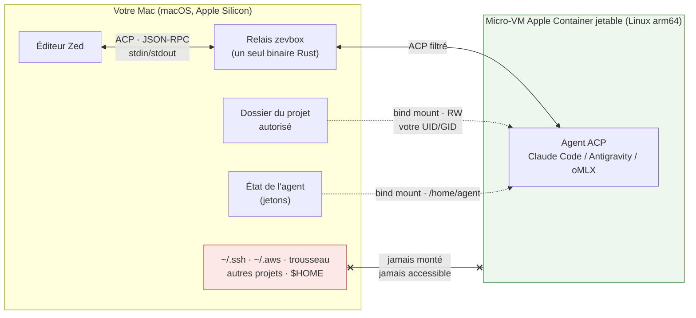
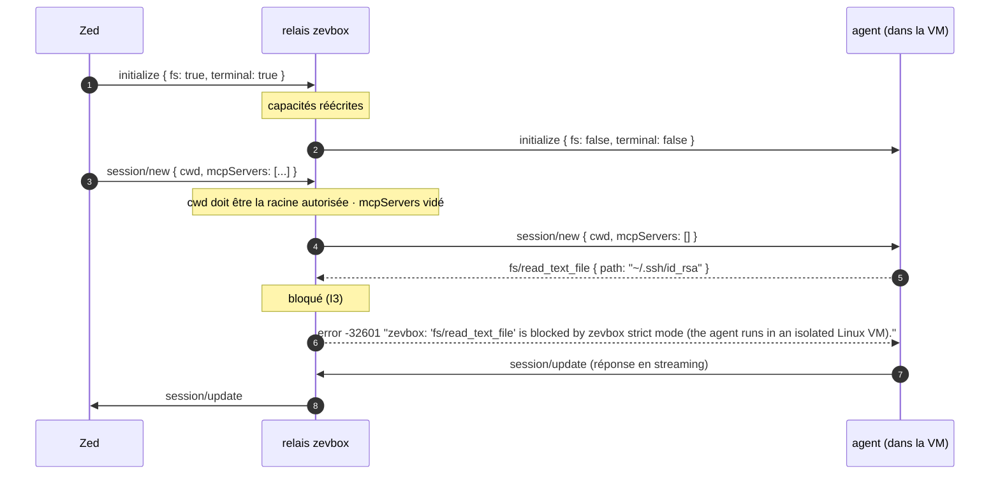
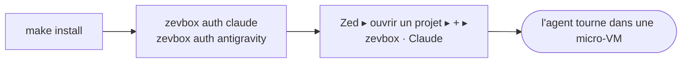
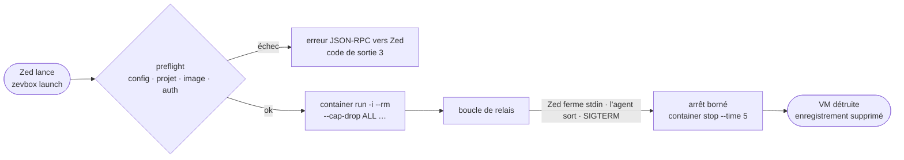

# zevbox — des agents IA pour Zed, enfermés dans des micro-VM Apple Container

[English](../../README.md) · **Français**

**zevbox** permet d'utiliser des agents ACP (**Claude Code**, **Google Antigravity** et, en
option, **oMLX** — Claude Code piloté par un modèle servi par [oMLX](https://github.com/jundot/omlx)
sur votre réseau local) depuis l'éditeur [Zed](https://zed.dev) sans jamais les laisser toucher à
votre Mac. Chaque agent
s'exécute dans une **micro-VM Apple Container** Linux jetable — une vraie machine virtuelle
isolée par le matériel, pas un conteneur à noyau partagé — et dialogue avec Zed à travers un
**relais ACP filtrant** qui supprime toute requête qui permettrait à l'agent de lire, écrire ou
exécuter quoi que ce soit sur l'hôte via l'éditeur.

Un seul binaire Rust · macOS sur Apple Silicon (arm64) · pas de démon · pas de Docker.

---

## Pourquoi

Quand Zed lance un agent ACP normalement, l'agent tourne **sous votre identité, sur votre Mac**.
Il peut lire `~/.ssh`, `~/.aws`, vos CLI adossées au trousseau et vos variables d'environnement ;
il peut exécuter n'importe quelle commande ; et le protocole ACP lui-même l'autorise à demander
à l'éditeur de lire, écrire et exécuter pour son compte (`fs/*`, `terminal/*`). Une injection de
prompt dans un README que vous lui avez demandé de résumer suffit.

zevbox donne à l'agent exactement deux choses — **le dossier de votre projet** et **son propre
dossier d'état** — et rien d'autre :

| | Agent lancé directement par Zed | Agent dans zevbox |
|---|---|---|
| Vos `~/.ssh`, `~/.aws`, trousseau, autres projets | lisibles | **jamais montés, invisibles** |
| Shell sur le Mac | oui | **non** — les commandes tournent dans une VM Linux jetable |
| Requêtes ACP `fs/*`, `terminal/*` vers Zed | honorées | **bloquées par le relais** (I3) |
| Fichiers créés hors du projet | atterrissent sur votre Mac | **disparaissent avec la VM** |
| Propriétaire des fichiers modifiés | vous | **vous** (même UID/GID, pas de root-squash) |
| Démarrage de l'agent | instantané | **< 1 s** (boot de la micro-VM) |

### À quoi ça ressemble



Le relais est la seconde moitié de l'histoire. ACP permet à un agent de demander à *l'éditeur*
de lire des fichiers, d'en écrire ou d'ouvrir un terminal **sur l'hôte**. zevbox répond lui-même
à ces requêtes et Zed ne les voit jamais :



### Pourquoi Apple Container plutôt que Docker

- **Barrière matérielle.** Chaque conteneur est sa propre micro-VM sur `Virtualization.framework`
  (ARM EL2). Un exploit noyau dans la VM doit encore franchir l'hyperviseur.
- **Rapide.** Les micro-VM démarrent un noyau Linux minimal en bien moins d'une seconde.
- **Partage de fichiers natif.** `virtiofs` offre des E/S quasi natives sur le projet monté.
- **Permissions correctes.** zevbox mappe votre UID/GID macOS dans la VM : les modifications
  vous appartiennent.
- **Jetable.** `--rm` + `--cap-drop ALL` : rien ne persiste hors des deux montages, et `root`
  dans la VM n'a aucune capacité Linux.

---

## Démarrage rapide

Pré-requis : Mac Apple Silicon, [Apple Container](https://github.com/apple/container) ≥ 1.5.0
(`container system status` → `running`), Zed, chaîne Rust.

```bash
# 1. Compiler et installer le binaire de production dans ~/.local/bin/zevbox
make install

# 2. Se connecter à chaque agent, une seule fois, ordre libre. Au premier passage, `auth`
#    initialise aussi zevbox et construit l'image de l'agent (réseau, 1-3 min) ; ensuite, rien n'est reconstruit.
zevbox auth claude        # compte Claude (Pro/Max) — dans un conteneur interactif
zevbox auth antigravity   # compte Google (AI Pro / One AI Premium) — OAuth PKCE sur le Mac
zevbox auth omlx          # optionnel : votre serveur oMLX (URL + clé API), p. ex. un Mac Studio
```



Zed affiche alors deux serveurs d'agent, **`zevbox · Claude`** et **`zevbox · Antigravity`**
(et **`zevbox · oMLX`** une fois `zevbox auth omlx` lancé).
Ouvrez un projet dans Zed et choisissez-en un avec **+** : ce choix vaut consentement, il n'y a
aucune liste de projets à tenir. Le projet doit être un dossier de votre dossier personnel (hors
`~/Library` et hors dossier caché `~/.…`) ou d'un disque externe ; ailleurs, l'agent répond
`… is not an allowed project` (invariant I2 : les dossiers dont le Mac exécute les fichiers tout
seul ne sont jamais montés dans une VM). `zevbox setup` fait tout cela d'un coup ; `init`,
`update` et `auth` restent disponibles séparément (voir la référence des commandes).

> Les connexions de Claude et d'Antigravity impriment l'URL de connexion : si le navigateur ne s'ouvre pas tout
> seul, copiez-la.

Parcours complet avec vérifications : **[GUIDE_UTILISATEUR.md](GUIDE_UTILISATEUR.md)**.
Fonctionnement et justification : **[ARCHITECTURE.md](ARCHITECTURE.md)**.
Documentation in English: **[README.md](../../README.md)**.

---

## Usage quotidien

- **Dans Zed** : ouvrez un projet, ouvrez le panneau agent, choisissez **zevbox · Claude**,
  **zevbox · Antigravity** ou **zevbox · oMLX** avec **+**. Le projet est celui ouvert dans Zed (son premier dossier
  racine). L'agent tourne dans une VM Linux temporaire dédiée, avec votre code monté sous votre
  propre UID/GID ; ses modifications apparaissent aussitôt dans votre dossier.
- **Committez vous-même le travail de l'agent** (ou avec un outil hors zevbox) : dans la VM, le
  `.git` du projet est en lecture seule ; l'agent lit l'historique mais ne committe pas (I13).
- **Modèles locaux (oMLX)** : le sélecteur de modèles de Zed liste ceux du serveur ; le modèle
  par défaut est le plus petit. Changer de modèle décharge le précédent sur le serveur, sauf ce
  plus petit modèle, que Claude Code garde pour ses petites requêtes de fond. Le changement est
  immédiat ; le premier prompt attend ensuite que le serveur charge le modèle. Le mode par défaut
  est **Bypass permissions** : l'agent ne demande jamais rien (il n'agit que dans sa VM et votre
  projet).
- **Shell interactif dans la VM de l'agent** : `zevbox shell claude`
- **Outils Linux supplémentaires (paquets apt) dans les VM** : `zevbox tools add ripgrep clang`
- **Vérifier et diagnostiquer** : `zevbox status` · `zevbox doctor`
- **Arrêter toutes les instances** : `zevbox stop`

---

## Référence des commandes

| Commande | Ce qu'elle fait |
|---|---|
| `zevbox setup` | Mise en place guidée et idempotente : écrit la configuration, construit les releases manquantes (`update`), propose `auth` pour chaque agent non authentifié (terminal uniquement), configure Zed, lance `doctor` et affiche un résumé par agent. L'échec de construction d'un agent ne bloque pas l'autre ; le code de sortie est 1 si un agent n'a toujours pas de release à la fin. L'agent optionnel oMLX n'est jamais construit par `setup` (utilisez `zevbox auth omlx`). |
| `zevbox init` | Crée les répertoires d'état (`~/.local/share/zevbox` ou Application Support) en mode `0700`, plus `config.json` (avec la taille de chaque VM d'agent, `resources` : 4 CPU et `4G` par défaut) et `tools.json`. |
| `zevbox doctor [--json]` | Contrôle complet : `container` ≥ 1.5.0, runtime actif, arm64, par agent : release, image présente et connexion (même test que `auth --status` ; oMLX : `optional, not installed`, ou le serveur testé depuis une VM), espace des images zevbox (WARN quand d'anciennes images sont récupérables), droits `0700` sur les dossiers d'état, binaire installé, entrées Zed à jour, instances orphelines, méthodes ACP refusées durant les 7 derniers jours (lues dans les journaux). Code de sortie 1 seulement sur `FAIL`. |
| `zevbox zed install [--dry-run]` | Insère sans rien casser les entrées gérées `zevbox · …` dans `~/.config/zed/settings.json`, en préservant commentaires et mise en forme (édition CST). Sauvegarde automatique dans `backups/` (les 20 plus récentes sont gardées). Affiche ce qu'elle a fait (`already up to date` ou `updated (backup: …)`) ; `--dry-run` affiche les entrées qu'elle écrirait et ne change rien. |
| `zevbox zed uninstall` | Retire toutes les entrées gérées de Zed et restaure les réglages à l'octet près. |
| `zevbox auth <agent> [--status]` | Claude : connexion interactive dans un conteneur `-it`. Antigravity : flux Google OAuth 2.0 PKCE **sur le Mac** (serveur HTTP éphémère `127.0.0.1:<port aléatoire>`, aucun port publié sur la VM, aucun accès au trousseau), écrit `state/antigravity/.gemini/antigravity-acp/{settings.json,acp_token.json}` en `0600`. oMLX (`zevbox auth omlx [--url <url>] [--model <id>]`, sur le Mac) : demande l'URL du serveur et la clé API (saisie masquée, ou lue sur stdin), liste les modèles du serveur, écrit `state/omlx/.claude/settings.json` (`0600` : URL, clé, modèles, défaut = `--model` ou le plus petit, hook de déchargement) et vérifie qu'une VM joint le serveur. `--status` affiche `authenticated`, `not authenticated` ou `unknown`. |
| `zevbox launch <agent> [--project <chemin>]` | Appelée par Zed : contrôle le projet (zones I2) et que l'agent est connecté (même test que `auth --status`), démarre la micro-VM, relaie ACP sur stdin/stdout avec filtrage strict et surveille le projet (I13). Sans `--project`, le projet est le répertoire courant (Zed lance l'agent dans le premier dossier racine). |
| `zevbox status [--json]` | Affiche les instances actives, orphelines ou non enregistrées (de ce dossier d'état seulement). |
| `zevbox stop [ID \| --project <chemin>]` | Arrête proprement les instances données, ou toutes les instances zevbox actives (jamais avec `--all`), et affiche une ligne par instance arrêtée. Un processus enregistré n'est signalé que s'il est toujours le même relais (jamais un processus qui réutilise simplement son numéro après un redémarrage) ; un relais qui ne répond pas sous 10 s voit son conteneur arrêté directement. |
| `zevbox clean [--images]` | Supprime les conteneurs orphelins vérifiés et les enregistrements obsolètes, supprime les conteneurs zevbox non enregistrés de ce dossier d'état seulement, purge les vieux journaux (>30) et sauvegardes (>20). Avec `--images`, supprime les images zevbox des releases de ce dossier d'état ni courantes ni précédentes (jamais les images d'autres outils ni d'un autre dossier d'état) et la VM de construction d'images, dont le disque ne rétrécit jamais. Elle supprime aussi les dossiers `releases/<id>/` des releases terminées ni courantes ni précédentes, et l'archive de construction d'Antigravity (~300 Mo) de chaque release (utile seulement pour construire ; son URL et son SHA-256 restent dans `lock.json`). |
| `zevbox shell <agent> [--project <chemin>]` | Bash interactif dans une VM jetable identique à celle de l'agent, protections I13 comprises (`.zed` masqué, `.git` existant en lecture seule). Sans `--project`, le dossier courant doit être dans une zone autorisée (sinon code 3). |
| `zevbox logs [ID] [--path]` | Affiche les 200 dernières lignes du journal de la session la plus récente, ou de l'ID donné. `--path` affiche le chemin du fichier. Chaque lancement y écrit son journal : stderr du conteneur plus les événements de zevbox (`launch agent=… container=…`, `blocked method=<m> dir=<d>` pour chaque méthode ACP refusée, `shutdown …`) au niveau `info` (`RUST_LOG=debug` pour plus ; pour les autres commandes, `RUST_LOG` écrit sur stderr). Uniquement des noms, chemins et identifiants : jamais un prompt, le contenu d'un fichier ni un jeton (I9). `zevbox doctor` liste les méthodes refusées trouvées dans les journaux des 7 derniers jours. |
| `zevbox update [--check] [--agent <agent>]` | Vérifie ou construit une nouvelle release depuis le registre ACP officiel, exécute le smoke test et la promeut. Sans `--agent` : Claude et Antigravity, plus oMLX s'il est installé. Sort avec le code 1 si la mise à jour d'un agent a échoué (rien n'est alors changé pour cet agent). Après une construction, fait le même ménage d'images que `clean --images`, et range toujours les dossiers et archives de releases. |
| `zevbox rollback [--agent <agent>]` | Permute la release active (`current`) avec la précédente ; refuse, avec la commande à lancer, si l'image de la release précédente n'existe plus. |
| `zevbox tools list` / `add <paquets…>` / `remove <paquets…>` | Gère les paquets Debian additionnels (`tools.json`) et reconstruit les images actives comme `update`, donc chaque agent passe aussi à sa dernière version. |

---

## Cycle de vie d'une session



## Ce qui persiste, ce qui ne persiste pas

| Donnée | À la fin d'une instance |
|---|---|
| **Code du projet** | Reste sur le Mac (modifications visibles immédiatement, même UID/GID). |
| **Identifiants de l'agent** | Persistent dans `state/<agent>` (monté sur `/home/agent` dans la VM). |
| **Fichiers temporaires hors projet** | Supprimés avec le conteneur (`--rm`, VM jetable). |
| **Journaux de session** | Persistent dans `logs/<instance_id>.log` (`zevbox clean` garde les 30 plus récents). |
| **Enregistrement d'instance** | Supprimé de `instances/<instance_id>.json` à l'arrêt propre. |

---

## Invariants de sécurité

Vérifiés par les tests et par `scripts/check-invariants.sh` à chaque `make check`, et jamais
affaiblis pour faire passer un test :

- **I1 — Deux montages seulement** : le dossier du projet et le sous-dossier d'état de l'agent. Jamais `$HOME`, `~/.ssh`, `~/.claude`, …
- **I2 — Projets dans les zones autorisées** : un projet est un dossier canonisé strictement dans votre dossier personnel (hors `~/Library` et hors dossier caché `~/.…`) ou sur un disque externe sous `/Volumes` ; `/`, les dossiers système, `/Applications`, `/opt/homebrew` et les dossiers de zevbox sont refusés. Écrire dans ces dossiers permettrait au Mac d'exécuter le code de l'agent.
- **I3 — Aucun accès à l'hôte via Zed** : toute requête ACP demandant à l'éditeur du système de fichiers (`fs/*`), un terminal (`terminal/*`) ou une authentification par terminal est interceptée et rejetée.
- **I4 — Liste blanche dans les deux sens** : seules les méthodes ACP connues et sûres passent entre Zed et l'agent ; les réponses sont routées par l'id de requête en attente.
- **I5 — `cwd` confiné** : le répertoire de travail est toujours exactement la racine du projet ; `mcpServers` est vidé, `_meta` et `systemPrompt` sont supprimés.
- **I6 — JSON-RPC pur sur stdout** : en mode `launch`, stdout ne porte que du JSON-RPC.
- **I7 — Pas de shell hôte** : zevbox ne lance jamais `sh`, `bash` ni `zsh` sur le Mac.
- **I8 — Ciblage chirurgical des conteneurs** : `container stop`/`delete` n'utilisent jamais `--all` et ne touchent que des conteneurs au préfixe `zevbox-` **et** au label zevbox ; `clean` ne supprime que les conteneurs non enregistrés de sa propre racine d'état (leur montage `/home/agent` est dessous).
- **I9 — Journaux privés** : aucun jeton, identifiant ou contenu de message n'est journalisé ni affiché en cas d'erreur.
- **I10 — Ni réseau ni build dans `launch`** : le lancement n'utilise que la release active.
- **I11 — Pas de panic en production** : zéro `unwrap()`, `expect()`, `panic!()` dans `src/` (Clippy `deny`).
- **I12 — zevbox hors de portée** : son binaire, sa configuration, ses releases et son code source ne sont jamais montés dans un conteneur : le dossier source de zevbox (et toute copie) est refusé comme projet, pour qu'un agent ne puisse pas modifier le code que vous compilez et installez.
- **I13 — Fichiers du projet que le Mac exécuterait** : dans la VM, le dossier `.zed` du projet est masqué (les écritures de l'agent restent dans la mémoire de la VM) et un `.git` existant est en lecture seule. La surveillance démarre avant la VM, et un `.zed` qui est un fichier ou un lien est refusé au lancement. Pendant la session, zevbox arrête l'agent si un `.git` apparaît ou change ailleurs. Motif : Zed lance tout seul des programmes indiqués dans `.zed/settings.json` et dans les réglages git (voir [ARCHITECTURE.md](ARCHITECTURE.md)).

### Modèle de menace et limites connues

zevbox protège **votre Mac** de l'agent. Il ne protège **pas** le projet que vous lui confiez :

- l'agent peut modifier ou supprimer tout le projet monté ;
- l'agent a accès au réseau, il peut donc exfiltrer le contenu du projet ;
- l'agent a accès à ses propres identifiants (c'est le rôle du montage d'état) — pour oMLX,
  l'URL et la clé API du serveur, en clair dans `state/omlx/.claude/settings.json` ;
- tout ce que vous envoyez volontairement depuis Zed (fichiers joints, texte collé) lui parvient ;
- aucune défense contre une faille du runtime Apple Container ou du relais lui-même.

---

## Dépannage par message d'erreur

- **`zevbox is not set up. Fix: run 'zevbox setup' or 'zevbox init'`** — lancez `zevbox setup` dans un terminal.
- **`<chemin> is not an allowed project: <raison>. Fix: open a folder inside your home folder …`** — le dossier ouvert dans Zed est hors des zones autorisées (I2), par exemple un dossier caché `~/.…` ou un dossier système. Déplacez le projet ou ouvrez un autre dossier.
- **`<projet>/.zed is a file or a link, so zevbox cannot mask it safely (I13). Fix: …`** — renommez ou supprimez ce `.zed` (un dossier normal convient), puis ouvrez un nouveau thread.
- **`zevbox: stopped the agent: it created or changed git metadata at <chemin>`** — l'agent a créé (ou modifié) un dépôt git dans le projet (I13). Vérifiez ce chemin et supprimez-le avant d'utiliser git ou de rouvrir le projet dans Zed.
- **`no active Claude release. Fix: run 'zevbox update --agent claude'`** — l'image de l'agent n'a pas encore été construite.
- **`Claude is not authenticated. Fix: run 'zevbox auth claude'`** — connectez-vous depuis un terminal.
- **`Antigravity is not authenticated. Fix: run 'zevbox auth antigravity'`** — connectez-vous avec votre compte Google dans le navigateur.
- **`oMLX is not authenticated. Fix: run 'zevbox auth omlx'`** — donnez à zevbox l'URL du serveur et la clé API.
- **`the Mac reaches <url> but the agent VM does not …`** (par `zevbox auth omlx` ; `doctor` : `not reachable from the agent VM`) — les VM ne sortent que par le réseau principal du Mac (l'interface de la route par défaut), pas par un câble direct vers le serveur. Utilisez l'adresse du serveur sur le réseau principal : `zevbox auth omlx --url http://<adresse>:<port>`.
- **`zevbox: this agent is bound to <A>; this session asked for <B>. Open <A> in Zed, or open <B> in its own Zed window …`** — la session Zed demande un dossier différent de celui où l'agent a été lancé, typiquement un espace de travail multi-racines. Ouvrez un seul dossier racine par fenêtre Zed.
- **`Auto mode unavailable: the selected model does not support Auto mode`** — le modèle par défaut de Claude dans la VM est Haiku 4.5. `zevbox doctor` signale `no default model` ; lancez `zevbox auth claude` (écrit `state/claude/.claude/settings.json`) ou écrivez-y `{"model": "fable"}`, puis ouvrez un nouveau thread Zed.
- **`Apple Container system is not running, and zevbox could not start it. Fix: … run 'container system start' …`** — zevbox démarre normalement le runtime seul (p. ex. après un redémarrage) ; sinon, lancez cette commande dans un terminal puis ouvrez un nouveau thread dans Zed.

---

## Contribuer

Issues et pull requests sont les bienvenues. `make check` (fmt, clippy `-D warnings`, tests,
invariants) doit passer ; `tests/**` et `scripts/**` sont protégés par un manifeste SHA-256 et
ne se modifient pas pour faire passer un changement. [AGENTS.md](../../AGENTS.md) décrit la carte
des modules, les invariants et le flux de travail — écrit pour des agents IA, c'est aussi la
meilleure orientation courte pour un humain. L'historique de conception est dans
`docs/DECISIONS.md`, `docs/PROGRESS.md` et les plans `zevbox_plan_V2.md` (contrat en vigueur) /
`zevbox_plan_V1.md` (remplacé).

## Licence

Double licence, au choix :

- [MIT](../../LICENSE-MIT)
- [Apache License 2.0](../../LICENSE-APACHE)

Sauf mention contraire explicite, toute contribution soumise intentionnellement pour inclusion
dans ce dépôt est réputée placée sous cette même double licence, sans condition supplémentaire.
